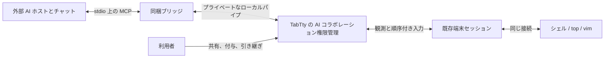

# AI コラボレーションの端末とアプリケーションの契約

Q35 でユーザーから委ねられた技術設計を 2026-11-14 に作成した。[ヒアリング](../drafts/ai-terminal-collaboration-issue.md)の製品判断 Q1～Q35 は合意済み。以下の数値上限とインターフェースの詳細は、委ねられた設計上の判断。ユーザーはテスト境界と、集約した仕様を `ready-for-agent` 付きの [GitHub Issue #2](https://github.com/TabTty/TabTty/issues/2) として公開することを確認した。実装と実測した検証結果は[実装状況](implementation-status-ja-jp.md#ai-collaboration-validation-2026-11-14)に記録する。この機能には固有のリリース検証条件がある。

[トランスポートとアクセス](ai-collaboration-transport-ja-jp.md)、[検証計画](ai-collaboration-validation-ja-jp.md)、[ADR 0005](../adr/0005-expose-existing-terminal-sessions-over-local-mcp.md)、[端末](terminal-and-encodings-ja-jp.md)、[セッションと入力](session-and-recording-ja-jp.md)、[同時送信と分割](broadcast-and-split-views-ja-jp.md)を併せて参照。以下で明示的に合意した AI の除外を除き、既存の挙動が優先する。

追加のアーキテクチャ Q12～Q20 は最終認識合わせを含め合意済みで、[保持履歴の観測モジュール設計](ai-history-observation-ja-jp.md)に集約した。履歴と検索の所有権と公開を具体化する。現在の実装のリファクタリングは今後の作業。

## 責務とインターフェース

外部 AI アプリケーションが会話、推論、タスク計画、ツール利用の判断を所有する。TabTty は会話の完了を調べたり、自然言語のタスク境界を強制したり、そのアプリが別途使えるツールを制御したりしない。同じ認可済みの連携先を使う複数の会話が、その連携先の権限を使える。クライアント表示名は本人確認に使わない。

GUI アプリケーションが AI コラボレーションモジュールを所有する。インターフェースには、連携先の接続と喪失、利用者による共有・付与・取り消し、上限付きの端末観測、入力要求、状態変更の結果がある。モジュールが権限を所有し、既存のセッション入力所有者と同時送信コーディネーターと調整する。stdio ブリッジはこの境界のアダプターであり、端末や独自の権限を別に持たない。WPF コマンドと MCP 要求には同じ権限検査を適用する。テストは制御可能なトランスポート、時計、スケジューリングのアダプターでこのインターフェースを通す。非公開コレクションには直接アクセスしない。

通常は、AI ホストにブリッジを手動登録し、TabTty で照合コードを合わせ、既存タブを共有し、外部チャットでタスクを伝える。利用者が操作権を付与すると、AI は画面を読み、操作を一つ送り、操作権を返すまで再度読み取る。利用者はいつでもタブメニューやステータスバーから引き継げる。**AIとの共有を終了** を選ぶまで閲覧は続く。

端末モデル、接続、記録、認証情報へのアクセス、クリップボードの所有権は既存モジュールに残す。AI の観測は不変の結果を使い、端末やロガーに渡す受信データを消費しない。UI 画面のスクレイピング、クリップボードの抽出、ログファイル読み取りは観測に使わない。

## 識別情報と権限

以下の識別情報はすべて不透明な文字列とし、プロファイルのパス、認証情報、HWND、トランスポートハンドルを公開しない。GUID 相当のランダム値で識別できる。識別子を持っているだけでは権限は付与されない。

| 識別情報 | 意味と有効期間 |
| --- | --- |
| 連携先 | 今回の起動中の検証済みプライベートブリッジ接続一つ。トランスポート契約に従って結び付け、`clientInfo` やチャットには結び付けない。 |
| セッション参照 | 連携先に限定された一つの共有タブ、接続世代、共有世代。共有終了、再接続、閉鎖で無効になる。 |
| 操作 ID | 利用者が付与した一回の入力許可期間。付与ごとに置き換え、返却、引き継ぎ、喪失で無効になる。 |
| 観測 ID | 認可された取得結果のセッション世代、操作権世代、レイアウト世代、入力完了の位置情報、画面メタデータへの上限付き参照。 |
| 継続トークン | 連携先、セッション、取得元に結び付いた画面ページまたは履歴範囲の継続。別連携先には移せない。 |

端末要求は受付時に連携先、セッション参照、共有世代、要求した権限を検査する。入力では最初のペイロードを送信受付する直前に操作 ID と接続世代を再検査する。検査と所有権の遷移はセッションとコーディネーターの順序付け領域で行い、検査後の送信に取り消し済みの権限を再利用できる隙間を作らない。

共有前の列挙はセッション一覧が空で、名前、接続先、ウィンドウタイトル、プロファイル、タブ数を返さない。未知のセッション ID も別連携先の ID も `not_shared` を返す。列挙は接続の `counterpart_id`、`pairing_code`、`interface_version: 1` も返し、タブの共有前でも GUI で選べるようにする。これらだけではアクセスは付与されない。共有セッションの記述子には不透明 ID、プロファイル表示名、接続状態、画面寸法、共有と操作の状態、使用可能な操作種別だけを含む。認証情報参照や保存設定は検出の対象外。認可済みセッションには送受信エンコーディングの識別子と対応入力機能を返せる。

認可済みセッションでは未知、期限切れ、別連携先の観測 ID は一律 `stale_observation`、未知、期限切れ、別連携先の範囲や継続ハンドルは `cursor_expired`。検証済みの保持範囲だけが `range_changed` または `range_evicted` を報告できる。無効な操作 ID は別の許可期間を開示せず、一律 `control_required` を返す。`not_shared` ではセッションのメタデータを返さない。

### 状態遷移

| 現在状態とイベント | 結果 |
| --- | --- |
| 未共有で利用者が接続済みの連携先と共有を開始 | 閲覧専用。新しいセッション参照を作り、同時送信からの除外をアトミックに適用する。 |
| 閲覧専用で利用者が操作権を付与 | 入力可能で競合所有者や保留中の人間入力がない場合だけ、新しい操作 ID と操作シーケンス 1 で操作中にする。 |
| 操作中に AI が返却、または利用者が引き継ぎ | 新規 AI 入力を即時に取り消す。必要な後処理中は引き継ぎ中、完了後は閲覧専用。 |
| 任意の共有状態で利用者が共有を終了 | 閲覧と入力を即時に取り消す。後処理はセッションが所有し続ける場合がある。その後は未共有。 |
| 操作中に部分送信の可能性がある障害 | 操作権を取り消し、到達未確認を報告して後処理する。タブと接続先が残れば閲覧共有を維持する。 |
| 接続済み端末が切断 | 操作権を終了する。通常の閉鎖方針でタブを保持する場合だけ閲覧共有を保つ。 |
| 保持タブで再接続 | 新しい世代を始める前に旧共有と旧識別子をすべて無効にする。改めて共有が必要。 |
| 連携先の喪失、アプリの終了、タブの閉鎖 | 該当する共有と操作権を終え、全ハンドルを無効にする。権限は復元しない。 |

既に閲覧専用の場合の操作権返却は、同じ共有と既知の操作許可期間に限って冪等な応答を返す。別の操作 ID や新しい操作 ID を取り消さない。共有開始と操作権付与は人間の UI だけで行える。AI ツールは操作権を返せるが、取得、更新、移転、拡大はできない。タブごとに連携先は一つ。一つの連携先が、独立して共有または操作を許された複数のタブを持てる。

人間の未完了入力、送信キュー、IME 合成、貼り付け、ボタン押下中のジェスチャーがある場合は、理由を表示して操作権の付与を拒否する。自身のセッションにチェックがなく一切受信しない場合も、同時送信のジェスチャーや貼り付けの入力元ペインを含む。プロトコル必須の応答だけでセッションを常時処理中にはしない。ネイティブ IME の完了またはキャンセルを実際に観測する。テキストを黙って確定して代用しない。付与を後で有効になるようキューに入れない。実行中または一時停止中のマクロが所有していれば AI への付与を拒否する。

### 取り消しと配信の境界

AI やブリッジの応答を待たず GUI 側で権限を取り消す。保留中の読み取り、検索、待機をキャンセルし、キャッシュしたハンドルを無効にする。GUI が上限付きの結果をプライベートなブリッジチャネルへ最終受付するときに閲覧権限を再検査する。この確定が出力の開示境界であり、取り消し後に端末ペイロードを新しく確定しない。既に確定したメッセージや OS またはホストのバッファーに入ったバイトは取り戻せない。ブリッジはまだキャンセルできる応答を破棄する。JSON フレームを途中で切りながら有効な応答と扱うことはない。障害でパイプを閉じた場合、部分フレームはプロトコル障害とする。

入力では既存の順序付けした取り消し時点を維持し、その後に新たなペイロードを受け付けない。実行中の貼り付けのキャンセルは共通の中止規則に従い、短い・長い書記素の途中でも完全なスカラー値または必要なより大きい不可分の符号化・制御単位で止め、CRLF は分割しない。取り消し後の追加ペイロードや不確定な送信の再実行を許可するものではない。他の入力は既存の完全な符号化単位によるキャンセル規則を維持する。取り消し後に許すのは、セッションが所有するエンコーダーまたはブラケットペーストの終端と、対応するマウス解放の後処理だけ。新規 AI 操作ではないため有効な権限は不要。Enter、Escape、Ctrl+C、終了コマンドを挿入しない。引き継ぎを瞬時に見せるためだけに正常なセッションを切断しない。

後処理完了までは人間の端末入力を拒否し、**引き継ぎ中** を表示する。ローカルの閲覧とコピー、切断は使える。5 秒後に入力の後処理が続いていることを表示し、強制切断や二つ目の書き込み元の受付は行わない。実際の送信障害は既存のセッション方針に従う。UI が引き継ぎを受理する時間とトランスポートの完了時間は独立する。受理の p95 目標は通常 100 ms、既存の過負荷試験で 250 ms。シリアル線の停止時間の実測値ではない。

## 同時送信とマクロとの相互作用

AI 共有、同時送信の選択とモード変更、タブ移動にはコーディネーターの一つのアトミックな遷移を使う。Q28 は AI が関わるタブだけに適用し、他タブは既存の同時送信契約に従う。

| 操作 | AI と共有するタブの規則 |
| --- | --- |
| アクティブな同時送信でチェック済みのタブの共有開始 | 共有を拒否する。利用者は先にチェックを外すかモードを終了する。 |
| 同時送信が停止中、または未チェックのタブの共有開始 | 他の条件を満たせば許可し、記憶したチェックをオフにする。 |
| 初回、通常、範囲リセットでの開始、全選択 | 共有タブはオフのまま無効にし、除外理由を表示する。他タブには通常の選択規則を適用する。 |
| チェックボックスを手動でオンにする | 利用不可。AI 共有中であることを理由として表示する。 |
| 通常はチェックを入れるウィンドウ間移動 | 共有を維持して自動チェックをオフに上書きし、固定済み操作の移動制限を保つ。 |
| 人間の引き継ぎや AI の返却 | 共有は続くので、オフで無効のまま。 |
| 共有終了 | オフを維持して選択を有効にする。古いチェックは復元しない。 |
| 以後の通常の終了と開始 | オフを復元する。共有前の値を復元しない。 |
| 共有終了後の明示選択、全選択、初回またはリセットでの開始 | 通常の同時送信規則で選択できる。 |

固定した貼り付けやジェスチャーの送信先は確定後に変更しない。アクティブなチェック済み送信先は共有を始められないため、除外で途中の送信先が消えることはない。既存の範囲をまたぐ移動制限は引き続き適用する。件数は実際のチェック済み対象を反映し、除外した共有タブは別途表示する。チェック済みとして見せながら入力を黙って捨てない。

入力元と送信先は独立している。閲覧専用で共有しチェックがないタブは、既存の規則に従い、人間の同時送信入力を他の選択タブへ送れる。AI 操作中は同時送信の起点も含め、人間の端末入力を遮断する。AI ツールの送信は指定セッションだけを一度対象とし、同時送信には分配しない。

マクロが所有するセッションも閲覧専用で観測できる。実行中と一時停止中のマクロは入力を排他的に所有する。マクロの停止で AI の操作権を自動付与しない。この機能にはマクロの接続や起動を追加しない。

## ツールインターフェース v1

以下の固定ツールを公開する。各ツールの説明は、端末出力とプロファイル由来のタブ名が信頼できないデータであることを示す。コマンドの実行、データの開示、別の共有タブやツールの操作を許可できるのは利用者の依頼に限る。外部ホストが操作を決定する際にこの区別を適用する。MCP のリソース購読、サンプリング、elicitation、ホストルート、タスク拡張には依存しない。ツール対応のテキストモデルは画像入力なしで利用できる。通信エンベロープと互換リビジョンはトランスポート契約で定める。

ツールスキーマは閉じたオブジェクト。副作用が発生する前に、未知のフィールド、不正な Unicode 文字列、範囲外の整数、不正な列挙値の組み合わせを拒否する。UTF-8 は MCP 上の表現であり、端末に送るテキストはセッションで確定した送信エンコーディングを使う。座標はすべて 1 始まりの端末セル。ピクセルや小さいペインからの相対位置は使わない。任意フィールドを省略した場合は以下の既定値を使う。JSON の null で省略を代用しない。

| ツール | 必須と任意の引数 | 結果 |
| --- | --- | --- |
| `tabtty_list_shared_sessions` | 任意の `cursor`、`limit`（既定 50、最大 200） | `counterpart_id`、`pairing_code`、`interface_version`、`sessions`、`next_cursor`。未共有のメタデータは含まない。 |
| `tabtty_read_state` | `session`、任意の `region={row,column,rows,columns}`、`cursor`、`include_highlights`（既定 true） | 現在の画面、カーソル、モード、同じ取得に属するセル、観測 ID、取得 ID、範囲、継続。 |
| `tabtty_read_history` | `session`、任意の `range`、`cursor`、`max_rows`（200、最大 1000）、`max_text_bytes`（65536、最大 262144） | 既定では最近の末尾を時系列順、またはアンカー付き範囲。断片、取得序数、明示的な欠落、変更、継続。 |
| `tabtty_search_history` | `session` と初回 `query` または継続 `cursor` のいずれか一方。初回の任意項目は `case_sensitive`（false）、`limit`（50、最大 200）、`context_lines`（2、最大 10） | 一致、上限付き文脈と範囲ハンドル、明示的な走査範囲と継続。 |
| `tabtty_wait` | `session`、`kind`（`change` または `delay`）、任意の `timeout_ms`（既定 1000、0～10000）。`observation` は change の場合だけ必須。 | `changed`、`no_change`、`elapsed`。最新のメタデータと観測だけを返す。 |
| `tabtty_send_input` | `session`、`control`、`action_seq`、`observation`、後述するタグ付き共用体 `input` | 配信結果、受理した操作シーケンス、現在の権限とレイアウトのメタデータ。コマンドの終了コードは推定しない。 |
| `tabtty_return_control` | `session`、`control`、任意の `reason`（最大 256 Unicode スカラー値） | 取り消し受理、後処理待ち、閲覧専用。理由は効果を持たない表示データ。 |

初回は `cursor` を省略する。継続は `session`（列挙を除く）と `cursor` だけを送る。トークンは元のオプションをすべて保持する。カーソルと新しい領域、範囲、検索文字列、制限は併用できない。すべてのカーソルはセッションと連携先に結び付く。成功したツールは構造化結果と、メタデータや範囲を維持した等価な上限付きテキスト表現を返す。両方の表現と JSON エスケープを合計結果の上限に計上する。上限内に収めるため成功応答からフィールドや完全なデータを黙って落とさない。

成功したセッションの結果には `status`、`session`、`connection_generation`、該当する `control_state`、結果固有のメタデータを含む。列挙は上記の独自エンベロープを持つ。利用不可や認可なしの結果は `status: "error"` と `error` だけを含み、セッションの詳細は返さない。エラー応答は `error.code` と英語や日本語に依存しない上限付きの機械用識別子を使う。ユーザー向けエラーは TabTty がローカライズする。任意の例外文、パス、要求本文、認証情報は返さない。不透明 ID は対象オブジェクトが存在する期間だけ診断上の相関情報として使う。

### 通信上のデータと履歴の取得方法

`tools/list` はページ分割せず、表の順に 7 ツールすべてを返す。各ツールは固定の英語説明と JSON Schema 2020-12 の `inputSchema` を持つ。タグ付き共用体の分岐と初回または継続の選択肢も含め、各オブジェクト階層に `additionalProperties: false` を指定する。構造化した成功とエラーの共用体の `outputSchema` を公開する。ID とトークンは最大 256 文字の不透明な ASCII 文字列。クライアントは解析しない。整数範囲は両端を含む。行、バイト、一覧の上限は正数。`context_lines` は 0 を許し、一致の両側の論理行数をそれぞれ指定する（各既定 2、最大 10）。テキスト、貼り付け、検索文字列は空を許可しない。修飾キーの既定は空配列。空のテキストは不正な引数で、シーケンスを消費しない。

7 ツールすべてで、ブリッジの `tools/list` 応答と GUI の引数読み取りに同じ定義を使う。定義には引数名、型、必須・任意、組み合わせ、既定値、上限・下限を含む。公開スキーマには適用できる標準の JSON Schema 制約を使い、各項目に固定の英語説明を付ける。スキーマのキーワードが使う単位と異なる制限は、その説明に正確な単位を明記し、GUI で検証する。この定義は共有状態や対応する二つのプロトコル版に共通する。現在の共有・操作権とハンドルの有効性の検証、重複した入力の処理は、各操作で定めた順序で引き続き GUI が行う。

ツール結果には `structuredContent`、`content: [{type: "text", text: ...}]`、`isError` を含む。テキストは同じ構造化オブジェクトを JSON として直列化したもの。操作エラーは `isError: true` と `structuredContent: {status: "error", error: {code, ...}}`、成功は `isError: false`。構造化結果には `status: "ok"` または `status: "error"` を使い、ツール固有の結果には以下のフィールドを使う。プロトコルエラーと版固有のラッパーはトランスポート契約に従う。構造化応答のプロパティ名はすべて snake_case とし、MCP 独自のプロパティ名は標準の表記を維持する。利用できない任意フィールドは省略する。次カーソルがない場合は明示した範囲を読み終えたことを示す。破棄済みの履歴が存在しなかったという意味ではない。

`range` は不透明な範囲ハンドル。クライアントから行インデックスは受け取らない。指定なしの初回履歴は、その呼び出し時点で見える保持終端までの上限付きの末尾を取得する。要求範囲の `range` と、古い内容が残る場合はその前の上限付きページの `earlier_range` を返す。いずれも次回の `range` に渡せる。`earlier_range` は元の行とテキスト上限を使い、現在ページの最初のアンカーの直前で終わる。繰り返すと過去へ進むが、各応答の中は時系列順。検索一致は同じ引数で受け付ける `context_range` を返す。JSON、行、テキスト上限で一度に返せない場合、`next_cursor` は要求範囲内を前方に継続する。ハンドルの範囲は開始を含み終端を含まない安定したコンテンツアンカーを使う。空範囲は明示する。以前のテキストを読むためにクライアントがアンカーを生成または解読する必要はない。

画面結果は `source`（`normal` または `alternate`）、`rows`、`columns`、`cursor={row,column,visible,style}`、`modes`、`observation`、`capture_id`、`capture_ordinal`、`captured_at`（UTC）、`expires_in_ms`、`requested_region`、`coverage`、位置付きの `lines`、任意の `next_cursor` を含む。各行は `row`、セルと属性の連続区間、該当する場合は行ごとに拡張した範囲を持つ。画面のメタデータとセルは同じ取得に属する。履歴結果は `source: "normal"`、`capture_ordinal`、`range`、時系列順の `fragments`、任意の `earlier_range`/`next_cursor` を含む。各断片は後述のアンカーと境界データを持つ。取得序数の範囲は現在の共有に限る。同じ保持中の論理行には、その共有内で履歴と検索が同じ不透明な識別子を返す。折り返しを変更しても識別子は維持する。検索は `matches`、`scanned_range`、`scan_complete`、任意の `next_cursor` を返す。一致にはテキスト、位置、`context_range` を含む。待機は `outcome`（`changed`、`no_change`、`elapsed`、`interrupted`）と最新の上限付きメタデータ観測を返す。画面セルは返さない。送信は `action_seq`、`sequence_consumed`、`delivery`（`pending`、`not_sent`、`submitted`、`possibly_partial`、`unknown`）を返し、許可期間が続いていれば `next_action_seq` も返す。検証済みの新規送信拒否は `status: "error"`、`error.code`、`delivery: "not_sent"`、`sequence_consumed: false`。受け付け済み操作の後のキャンセルや失敗は、最終的に送信ゼロでも `sequence_consumed: true` を変更しない。キャッシュ結果の喪失には `delivery: "unknown"` を使う。操作権返却は `control_state` と `cleanup_pending` を報告する。認可済みの一覧や状態の記述子では、操作中なら現在の `control` ID を含むため、新規付与を知るための追加ツールは不要。

## 画面観測と古い観測に基づく操作

許可されたローカルエコーを含む統合表示モデルから取得する。描画、ペインのフォーカス、スクロールバックの閲覧から独立させる。グリッド寸法、通常と代替の選択、カーソルの行、列、表示、形状、実効キーパッドとカーソルキー、マウスと報告形式、ブラケットペーストのモードを返す。取得元を明示する。Vim モードやシェルコマンドの完了までは判定しない。

行には `column`、`width`、文字どおりの `text` を持つ位置付き書記素クラスタと、連続区間単位の表示属性（前景、背景、太字、淡色、斜体、下線、反転、非表示、取り消し線）を含む。空白区間と幅広セルの継続位置を明確にする。固定の端末既定色と実際に受信した色を使う。非表示は表示用フラグであり、コピー可能な元テキストは認可済みモデルに残る。生の ANSI/OSC シーケンスは公開しない。

要求された場合は、同じテキストとルールのリビジョンに一致する現在のキャッシュ済み強調だけを含め、`highlight_status=current\|pending` を返す。強調を待ったり、受信や UI の所有者で計算したりしない。ペイン固有の選択、検索装飾、IME 合成、フォーカス枠、アプリの外枠は省く。共有されたライブ画面は、人間側でどのペインにフォーカスしているかに依存しない。

内容の変化と操作の適格性には別の識別情報を使う。通常と代替の選択、寸法、状態を再初期化する端末リセットのたびに `layout_epoch` を増やす。以前の値へ戻す変更（ABA）も含む。テキストの更新、カーソル移動、色変更で変更待機を起こせるが、それだけで操作を古くしない。現在対応する端末モードで入力を解決し、ジェスチャーのマウス報告世代は別に追跡する。

事前検査と最初のペイロード受付の両方で、操作の観測が期限内にあり、接続世代とレイアウト世代が一致する必要がある。条件を満たさなければ送信せず `stale_observation` を返す。入力の処理中にも接続先の状態は変化し得る。接続先とのアトミックなトランザクションや、意図したアプリモードは保証しない。観測を現在の操作権世代に結び付け、利用者による付与ごとに最初の読み取りを要求する。権限内の `action_seq` と別に、セッション世代全体で単調な入力受付と完了の序数を保持する。操作に使える観測は、AI の送信が処理中でなく、最後に受け付けた送信の完了後に取得したものだけ。新しい入力の受付時には、その観測の完了位置が現在のものと一致する必要がある。送信中のスナップショットは完了後の次の送信を許可できない。テキストが変わっていなくても、送信完了ごとに新しい状態読み取りの観測を要求する。待機メタデータで画面観測は代用できない。意図的な一回の複数行貼り付けは許しつつ、観測のないコマンド連鎖を抑える。Q23 の後処理は古さの検査から除外する。観測の期限が切れたら再観測が必要。有効でアイドルな操作権は失わない。

上限付きの一領域の状態ページには、一つの不変の取得結果を使い、範囲、取得序数と時刻、固定期限を示す。既定はアクティブ画面全体。その取得がスナップショット予算を超えたら、寸法と収まる領域の提案を添えて `region_required` を返す。複数の領域取得で画面を網羅できる。黙って切り出したり、別々の取得結果でアトミックな全画面スナップショットを主張したりしない。領域は現在のグリッドに収まる必要がある。行ごとに、要求したセルと交差するクラスタ全体を含むよう左右の境界を広げ、実際の行範囲を報告する。幅広セルの継続位置から始まる領域には、その先頭クラスタを含める。分割や暗黙の省略は行わない。最大グリッドや最大クラスタでは領域指定が必要な場合がある。コピーで無制限の端末履歴を固定しない。

## 保持履歴の表現と整合性

統合した通常画面のアクティブ行とスクロールバックを読む。代替画面の背後にモデルを退避している間も対象。代替画面の再描画は履歴に含めない。Unicode スカラー値、実際の空白、意味のある末尾空白を維持し、合成した空白埋めは除く。論理行のメタデータでソフトラップを結合する。ハード境界を `line_end=true` で表し、ページ境界で架空の LF を作らない。テキスト表現で LF を使うのは明示された境界だけ。

断片には再利用しない論理行 ID、安定した範囲アンカーとリビジョン、クラスタオフセット、`continues_before/after`、前後の保持情報を持たせる。オフセットは完全なクラスタ単位とし、サロゲートペア、クラスタ、幅広セルの内容を分割しない。長い論理行は複数ページにまたがる。最新の末尾の初回取得には、保持しているさらに古い内容を要求できるアンカーを含める。割り当て上限による除去や消去（`range_evicted`）、保持部分の編集（`range_changed`）、メタデータの期限切れ（`cursor_expired`）を区別する。セッション契約の安定したコンテンツ範囲の同一性を使う。長い未確定行への追記で行全体のリビジョンが進んでも、変更していない要求済み先頭部分は無効にしない。先頭除去後も残存オフセットに番号を振り直さない。要求アンカーの喪失を含め、欠落した先頭部分を明示する。

履歴ページは要求した上限内の現在の範囲だけをコピーする。継続には上限付きの端点とリビジョンのメタデータを保持し、凍結した記録全体は保持しない。変更のない範囲の後への通常の追記では無効にならない。要求範囲が変化したら、置き換え内容を返す前に報告する。安定したコンテンツアンカーは通常のソフト再フローでも維持される。要求した先頭部分の除去は明示的な損失。無制限の削除履歴は不要。メタデータが残っていなければ、正確な損失履歴が分かると主張せず `cursor_expired` または利用不可を返す。

検索はリテラルで、既定は OrdinalIgnoreCase、指定時は Ordinal。`query` の説明には 1,024 UTF-16 コード単位という上限を明記する。JSON Schema の `maxLength` は Unicode コードポイントを数える。たとえば U+1F600 を 512 個並べると上限ちょうどになり、513 個では GUI の上限を超える。公開スキーマと GUI は、検索文字列のどの位置でも CR（U+000D）と LF（U+000A）を拒否する。U+0085、U+2028、U+2029 など、ほかの Unicode の改行・区切り文字は、保持テキストにその文字がある場合にリテラルとして一致する。正規化や文字幅・カナの同一視は行わない。ソフトラップを結合し、ハードな論理行はまたいで一致させない。

AI 用の独立した検索カーソルを使い、人間側のペインの検索文字列や選択を変えない。初回要求で取得した固定終端アンカーまで古い順に検索する。それ以後の追記は範囲外。一時作業予算の中でテキスト最大 256 KiB の不変の走査窓を取得し、最大 `query.length - 1` UTF-16 コード単位を完全なクラスタ境界に丸めて境界を拡張する。これで一つの論理行内の窓をまたぐ一致を見つけ、一致の開始を含む窓だけに割り当てて重複を避ける。文脈には同じ整合した取得結果を使い、その上限付き範囲ハンドルでページングできる。

ページ公開前に、走査進捗が進む範囲全体の変更と保持の証明を検証する。一致しなかった領域、重なり、文脈を含む。一致した行だけを検証しない。範囲が変化したらカーソルを進めず `range_changed` または `range_evicted` を返す。再試行には新規要求が必要。範囲の証明には上限付きの集約範囲リビジョンのメタデータを使い、行ごとの無制限なカーソルコピーは使わない。継続時は残りの要求範囲を検証する。固定終端の先の追記では無効にならない。バックグラウンドの上限付き区間で走査し、作業予算内で一致がなくても継続を返す。`scan_complete` は公開したページごとの走査範囲で固定終端に達したことを示す。現在の履歴に他の一致がないことまでは示さない。ページは公開時に整合する。返却済みページは遡及更新せず、連続ページはバッファーを凍結したトランザクションではない。

通常の履歴ページも公開直前に内容の依存関係を検証する。履歴と検索は同じ最終認可と非ブロッキングのキュー受付経路を使う。テキストを元に戻しても途中の編集は変更とし、内容の一致だけでは不十分。準備した履歴や検索の後続ハンドルは、受付成功時にだけ有効になり、それぞれ固定 60 秒の期間を得る。元のハンドルの解決では消費も期限更新もしない。仮登録、上限付きの検証、サイズ計算、障害の後処理はモジュール設計で定める。

## 入力操作、順序、重複の抑止

`input.kind` は次のいずれかとし、記載したフィールドだけを許可する。

| 種類 | フィールドと挙動 |
| --- | --- |
| `text` | `text` は印字可能なテキストだけ。C0/C1/DEL、改行、自動 Enter は含まない。セッションのコーデックで符号化する。 |
| `key` | `key`、任意の `modifiers` は Shift/Alt/Ctrl の重複なしの要素。名前は `Enter`、`Backspace`、`Tab`、`Escape`、`ArrowUp`、`ArrowDown`、`ArrowLeft`、`ArrowRight`、`Home`、`End`、`Insert`、`Delete`、`PageUp`、`PageDown`、`F1`～`F12`、`Numpad0`～`Numpad9`、`NumpadDecimal`、`NumpadAdd`、`NumpadSubtract`、`NumpadMultiply`、`NumpadDivide`、`NumpadEnter`、または印字可能なスカラー値一つ。未対応の組み合わせを拒否し、既存の端末規則で対応付ける。デスクトップのショートカットは使わない。 |
| `paste` | `text` と任意の `character_delay_ms`/`line_delay_ms`（0～10000、既定 0）。リテラルテキストは TAB/CR/LF を含められる。他の C0/C1/DEL は許さない。暗黙の Enter や改行変換は行わない。取得済みのブラケットペーストモード、既存の事前検査、エンコーダー終端を使う。人間向けの記憶済み貼り付け設定は変えず、クリップボードにアクセスしない。 |
| `mouse` | `action` は press/release/move/wheel、`row`、`column`、任意で重複しない Shift/Alt/Ctrl の `modifiers`。press/release は left/middle/right の `button` が必須で `wheel` を禁止。move は両方禁止。wheel は up/down の `wheel` が必須で `button` を禁止。押下状態はセッションから得る。移動時にクライアント指定のボタン状態は受け取らない。未対応のモード、イベント、座標は送信せず拒否する。送信した押下を追跡し、対応しない解放を合成しない。 |

AI のマウスイベントは明示的な接続先端末操作。Shift はイベントの修飾キーとして扱う。既存の単一セッションの符号化と報告に従い、従来形式の座標処理も含む。座標を範囲内に収めた場合は実効座標を返す。マウス操作で Windows のポインターは動かない。モード世代が変わったらジェスチャーの追跡をキャンセルする。引き継ぎ時は、元の接続と報告世代でまだ解放を許す送信済み押下だけを、現在のグリッドと形式の範囲内で可能な限り解放する。ホイール、押下のみのイベント、新しい接続やモードに対する旧ボタンの解放は送らない。

入力は既存の一つのセッション所有者を通し、単位全体の事前符号化検査、既存のローカルエコーと記録の規則、プロトコル応答の通常の順序に従う。直接の SSH exec チャネル、独立したシェル、生バイトの迂回経路、秘密の取得、自動再試行は公開しない。Ctrl+Shift+C/V のようなローカルメニューのショートカットは AI のキー操作として拒否する。端末対応の通常の Ctrl+C は明示的なリモート操作として扱い、人間による引き継ぎとは区別する。

`action_seq` は操作許可期間内の 1..2147483647 の整数。次のシーケンスだけを受理し、セッションごとに新規 AI 送信は同時に一つまで。基本の共有と操作権の検証後、新規送信の観測、符号化、リソース検査より前に最大受付番号と重複台帳を参照する。次の新規シーケンスに限りこれらの検査を行う。受付済みシーケンスの観測が期限切れになったり画面やコーデックが変わったりしても、`not_sent` と扱わない。送信前の拒否は `not_sent` を返し、修正要求で番号を再利用できる。受理したら送信前に最大受付番号、正規化したダイジェスト、保留中の結果をアトミックに記録する。

直近 256 件の受付済み結果と正規引数ダイジェストを上限付き台帳に保持し、許可期間全体の最大受付番号も保持する。受付済み要求を繰り返しても再送しない。引数が一致すればキャッシュした保留や結果を返し、一致しなければ `sequence_conflict`。台帳から外れた古い受付済み番号は `already_processed` と結果利用不可を返す。実行は行わない。次より大きい番号は `sequence_gap`。タイムアウト、キャンセル、履歴消去、レイアウト変更でシーケンスをリセットしない。枯渇したら返却して利用者に新しく付与してもらう。正規引数は解析済みの型付きフィールドを契約の固定順序で、既定値を明示し、修飾キーを Shift/Alt/Ctrl の固定順で直列化したもの。オブジェクトキー順や空白は無関係。受付時に .NET の暗号機能で SHA-256 ダイジェストを保存し、転送完了後に長い入力本文を解放する。台帳にはダイジェストと上限付きの結果だけを残す。

送信完了は `submitted` を返す。リモートでの実行成功は示さない。未送信入力をキャンセルしたら `not_sent`、先頭部分を送った後のキャンセルや失敗は `possibly_partial`/`send_uncertain` として操作権を終了する。ツール応答を失っても投入は取り消せない。権限の取り消し後に重複要求を送っても復元できない。旧許可期間が終了したことを報告し、入力は送らない。モデルは新しいシーケンスで無条件に再試行せず、再観測するか利用者に確認する。

## 待機、キャンセル、エラー、リソース

変更待機は認可済み観測のメタデータを、テキスト、カーソル、表示属性、画面、モードの変更と比較する。UI のキャレット点滅とペイン固有のオーバーレイは除く。比較と待機登録はアトミックに行い、その間の変更を取り逃さない。既に変更済みなら速やかに返す。時間待機は `elapsed`、対象の変更がないまま期限に達したら `no_change`。どちらもコマンド終了コードは示さない。共有セッションごとに待機は一つまで。追加は `busy`。待機中も読み取り、列挙、人間の引き継ぎは可能。切断、操作権喪失、共有喪失では明示的な状態とともに待機を中断する。無期限の MCP 呼び出しは不要。

読み取り、検索、待機のキャンセルはその操作だけを止める。受付済み送信のキャンセルでは未送信末尾を止め、引き継ぎと同じ安全な後処理で操作許可期間を終える。ホストのタイムアウトから接続先での取り消しを推定しない。公開のキャンセル通知は要求を出した連携先に限定する。新しい JSON-RPC 要求 ID で操作シーケンスの重複排除を迂回できない。

共通エラーコードは `invalid_request`、`not_shared`、`control_required`、`stale_observation`、`range_changed`、`range_evicted`、`cursor_expired`、`busy`、`resource_limit`、`region_required`、`unsupported_action`、`sequence_gap`、`sequence_conflict`、`already_processed`、`send_uncertain`、`cancelled`。不正または未対応の通信要求にはプロトコルエラーを、アプリケーションの結果にはツールエラーを使う。エラーで入力を自動再試行したり、AI の読み取りキャッシュ解放のために正常な端末を切断したりしない。端末状態の回復不能な障害には既存のセッション方針を適用する。

| リソース | 初期の技術的制限 |
| --- | --- |
| MCP とプライベートのフレーム | エンベロープ込みで直列化済み UTF-8 JSON 最大 2 MiB。無制限な割り当て前に拒否する。 |
| ツール結果 | 構造化結果、テキストのミラー、エスケープを含め最大 1 MiB。超過前にページ分割する。 |
| テキストページ | UTF-8 テキスト既定 64 KiB、最大 256 KiB。物理行は既定 200、最大 1000。実際の JSON 予算で内容を減らし継続を返すことがある。 |
| 画面領域スナップショット | 一取得 16 MiB、連携先ごとに 2 取得、アプリ合計 64 MiB。固定 TTL 60 秒。完了や取り消しで早期解放する。 |
| 観測と履歴カーソルのメタデータ | 連携先ごとに 256 ハンドル、アプリ全体で 4096。固定 TTL 60 秒。履歴テキストを固定しない。古いものから失効させ、明示的なエラーを返す。 |
| 連携先と処理中呼び出し | アプリごとに 8 接続、連携先ごとに通常呼び出し 16。待機による取り消しの枯渇を防ぐため、返却、キャンセル、制御に別枠を予約する。 |
| 呼び出し頻度 | 通常呼び出しは連携先ごとに 20 件/秒（バースト 40 件）、アプリ全体で 100 件/秒（バースト 200 件）。新規送信にはタブごとに 5 件/秒（バースト 10 件）も適用する。操作権の返却要求には連携先ごとに独立した 4 件/秒（バースト 8 件）の枠を用意する。上限を超えた要求には `retry_after_ms` 付きの `busy` を返す。 |
| 検索 | 一致の既定 50、最大 200。文脈は片側最大 10 論理行。協調走査区間 20 ms、呼び出しごとの作業予算 100 ms。その後は継続を返す。 |
| 待機 | 既定 1000 ms、最大 10000 ms。操作権のアイドル時間は無制限。 |
| 入力 | AI 入力テキストは送信先の符号化前の UTF-8 で 256 KiB 以下。処理中の AI 送信は一つ。送信先別の貼り付け作業と通常入力は、既存のセッション入力枠 2 MiB/256 単位と既存の終端予約を共有する。共有原文一つ・共通作業・実際の送信先別作業はアプリ全体の共有 4 GiB 枠へ収める。固定の確定符号化後の貼り付け上限や追加の貼り付け枠は設けない。 |
| AI の一時作業 | キュー、コピー、直列化、履歴と検索の作業はアプリ全体で 64 MiB。別計上のスナップショット予算 64 MiB に追加する。連携先ごとのトランスポートペイロード 8 MiB は一時作業予算の内数。実際のマネージドとネイティブの所有分を数える。 |

共有予算と維持する本文サイズ・確認要件を組み合わせた Q26 を含む、合意済みのコードベース全体のアーキテクチャ Q20～Q22、Q24～Q27 は、共通の貼り付けと保存区間の仕組みを変更する。候補 6 全体の最終確認 Q23 は 2026-11-18 に完了した。AI が渡す `paste.text` は引き続き UTF-8 で 256 KiB 以下とし、クリップボードにアクセスせず、人間向けのクリップボード確認を表示しない。人間向けの設定可能な本文上限（既定 512 MiB）と CR/LF または 1024 バイト超による確認条件を、AI が渡すテキストへ適用したり、UTF-8 256 KiB 要求上限の代わりにしたりしない。有効な入力書記素が長くても 256 スカラー値で拒否したり、表示の保持接頭辞へ切り詰めたりしない。通常の送信成功時は受け付けた本文全体を維持する。全文の厳密な符号化事前検査、権限、観測検証、送信所有者が一つという要件を維持する。

[共有貼り付け本文と既存の入力作業](resources-and-validation-ja-jp.md#共有貼り付け本文と既存の入力作業)を使う。不変の原文・共通計画はアプリの共有 4 GiB 枠で所有し、送信先は原文全体を各 2 MiB 入力枠へ重ねて計上せず参照する。送信先固有の作業は通常入力と既存の入力枠を共有する。中止・終端の事前予約と実解放までの計上を維持する。既存の AI 要求・トランスポート・一時作業バッファーは実際の解放または所有権移転まで自身の上限を維持する。物理的に移転した割り当ては新しい所有者で一度だけ計上し、架空の重複割り当てを作らない。実際に重なるコピーは別々に計上する。通常の `text` 入力は既存の計上と外部要求上限を維持する。

生のテキスト上限に加えて直列化済み JSON の予算を適用する。履歴と検索ではテキストミラーを含む実際の合計結果をプライベートチャネルのキュー受付前に検査し、ブリッジ側の防御的検査も維持する。実装容量は最大の完全な保存区間（256 スカラー値、UTF-8 で 1024 バイト）を収められる必要がある。保持接頭辞を連結して再分節せず、Rust の正本の保存区間を使う。保存接頭辞の省略方針は観測時の追加切り詰めを許可しない。ページは完全な保存区間の境界で短くし、対応する継続を返す。暗黙の切り詰めは行わない。明示した max_text_bytes が次の完全な保存区間に足りなければ進捗なしで resource_limit を返す。上限を超えたり空の継続を繰り返したりしない。スナップショットメモリと要求バイトは、キャンセル済みを含め下層 I/O の完了まで計上する。不足時は新しい AI 作業だけを拒否し、端末履歴を除去したり受信を止めたりしない。測定後に調整できるのは、合意済みの障害と保持の挙動の範囲内だけ。新しいユーザー設定や性能の保証ではない。

呼び出し枠は単調時計を使い、検出、列挙、読み取り、待機を含む。ブリッジは GUI に転送する前に、その接続の操作権返却枠を確認する。GUI 側でもパイプから受信した時点で連携先ごとの返却枠を確認してから、要求に必要なメモリを確保して UI スレッドに処理を渡す。無効な宛先への要求や返却済みの操作権に対する再確認も対象になる。上限に達して返却を受け付けなかった場合は、その時点の操作権が続く。利用者による操作権の取り戻し、キャンセル、死活監視にはそれぞれ独立した処理容量を確保する。受付済みの重複送信は追加の新規送信枠より先に検査する。頻度制限で拒否しても `action_seq` を消費せず、古い操作が未送信だったとは保証しない。

## UI とオフライン動作

共有と操作のどちらの確認画面にも、タブ名、接続方式、接続先を表示する。承認対象のセッションが保持している SSH のアカウント・ホスト・ポート、Telnet のホスト・ポート、またはシリアルポートを使う。切断後に保持しているセッションにも適用する。これらの接続先情報はローカルの確認画面に限って表示する。識別情報の書式制御文字や改行は Unicode コードポイントとして可視化する。共有を開始または切り替える前に、Windows が記録したブリッジの親プロセスのパスと PID、連携先の照合コードを表示する。権限を付与する接続は外部 AI アプリのコードと照合して確認する。この接続を共用するプログラムやチャットが同じ権限を利用でき、AI アプリが現在画面を取得し、保持中の通常画面の履歴を検索できることを明示する。共有開始前の出力や、共有を終了していた間の出力も対象となる。表示またはエコーされた秘密が残っていれば、再共有時に読み取られ得る。切り替えでは、確定時に共有を終了する旧連携先も示す。

操作権を新たに付与するときも個別に確認する。対象のタブと連携先を示し、接続先端末で利用できる権限で、都度の確認なしにキーや複数行のコマンドを入力できることを説明する。どちらの確認もキャンセルを既定とする。無人作業を継続できるよう、Windows のロック、ユーザー切り替え、リモート デスクトップ切断だけでは共有と操作権は終了しないことを両方の確認に明示する。端末や連携先の切断時は通常の失効条件に従う。確定前に接続、連携先、共有と操作権の世代、および通常の許可条件を再検証する。共有中のタブのステータスバーには、AI 操作中や人への引き継ぎ中も「AIとの共有を終了」を常設する。操作を引き継いだ後も閲覧は続く。

タブの要素は、該当時の同時送信チェック、既存の接続表示、AI 状態アイコン、従来のプロファイル名、既存の注意と閉鎖の順。閲覧専用共有は輪郭の目、AI 操作は小さな再生三角形のある端末の矩形。テーマに応じた線と異なる形を使い、点滅や色だけで区別しない。未共有時に AI アイコンは表示しない。閲覧共有と切断の表示は並べて見えるようにする。引き継ぎ中はステータスや詳細で示し、後処理完了までは操作アイコンに遷移中のアクセシブルな説明を付けて維持する。

英語と日本語のリソースラベルには `AI sharing (read only)` / `AI共有中（閲覧のみ）`、`AI controlling` / `AI操作中`、`Taking control` / `引き継ぎ中`、`Share output with AI` / `AIと出力を共有`、`Give control to AI` / `AIに操作を任せる`、`Take control from AI` / `AI操作を中断して引き継ぐ`、`End AI sharing` / `AIとの共有を終了` を含む。リソース識別子はラベルから独立させる。ステータスで引き継ぎ理由を表示する際は別の行とし、AI 連携先からのメッセージであることを示す。申告された連携先名と、上限付きの引き継ぎ理由から表示制御文字を除く。パスワードやワンタイムコードの入力を人に引き継ぐ場合、外部ホストは入力前に共有を終了するよう案内する。保存した端末テキストは変更しない。

コンテキストメニューとステータスの操作には UI Automation の名前と状態、キーボード操作を提供する。グローバルな引き継ぎに端末キーを予約しない。共有と操作の状態遷移を読み上げる。受信したすべての文字は読み上げない。利用できないコマンドは理由を示す。手助けの要求は外部の会話に残す。モーダルの AI ダイアログ、フォーカスの奪取、自動前面化、新しいクリップボードアクセスは行わない。

設定は同梱ブリッジの標準構成を表示してコピー可能にし、ホストごとの手動手順を提供する。別アプリの設定を編集したりモデルをインストールしたりしない。この機能はプロバイダーキーやモデルエンドポイントを `.ttty` に保存しない。外部 AI アプリケーションが推論と独自のデータ取り扱い設定を所有する。オフライン動作にはホスト、モデル、ランタイム、ブリッジを事前に用意する必要がある。クラウド構成の AI にローカル MCP ブリッジを使っても、データがローカルだけに留まるとは限らない。テレメトリや AI ペイロードの監査ログは追加しない。

通常のセッション記録はプロファイルに従って続ける。新しいマーカーや記録への注入は行わない。アプリ診断に記録できるのは上限付きの操作種別、結果、時間だけ。端末テキスト、入力、検索文字列、引き継ぎ理由、認証情報、完全な MCP フレームは記録しない。出力自体に秘密が含まれ得る。一般的な伏字化やプロンプトインジェクションへの耐性は保証しない。

## 実装と配布の条件

製品上の未決事項は Q35 までに解消した。この契約と関連文書で委ねられた設計を完了した。新しい依存関係方針の例外や初期リリースの変更は選んでいない。ユーザーはテストの境界を確認し、統合仕様の公開を依頼し、その後に実装を承認した。配布前に、プロトコル、Windows、オフライン、ホストとモデル、性能、障害の証跡を検証計画で追跡する。
