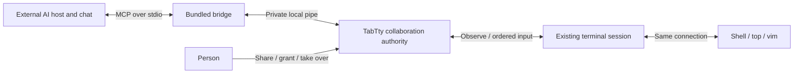

# AI collaboration: terminal and application contract

Technical design prepared 2026-11-14 under the user's delegation in Q35.
Product decisions Q1-Q35 in the [interview](../drafts/ai-terminal-collaboration-issue.md)
are accepted. Numeric guards and interface details below are delegated design
choices, not measured results. The user confirmed the testing boundary and
publication of the synthesized specification as
[GitHub issue #2](https://github.com/TabTty/TabTty/issues/2), labelled
`ready-for-agent`. Implementation and measured validation results are recorded
in [implementation status](implementation-status.md#ai-collaboration-validation-2026-11-14).
This feature has its own release validation gate.

Read with [transport and access](ai-collaboration-transport.md),
[validation plan](ai-collaboration-validation.md),
[ADR 0005](../adr/0005-expose-existing-terminal-sessions-over-local-mcp.md),
[terminal](terminal-and-encodings.md), [session/input](session-and-recording.md),
and [broadcast/splits](broadcast-and-split-views.md). Existing behavior takes
precedence except for the explicitly accepted AI exclusions below.

Architecture follow-up Q12-Q20 is accepted and consolidated in the
[retained-history observation module design](ai-history-observation.md), including
the final shared-understanding review. It refines history/search ownership and
publication; it does not claim that the current implementation has been refactored.

## Responsibility and interface

The external AI application owns conversation, inference, task planning, and
tool-use decisions. TabTty does not inspect conversation completion, enforce
a natural-language task boundary, or control tools separately available to that
application. Multiple conversations using one authorized integration can use
that integration's grants; a client display name is not verified identity.

The GUI application owns an AI collaboration module. Its interface comprises
counterpart attachment/loss, human share/grant/revoke commands, bounded terminal
observations, input requests, and state-change results. It owns authority and
coordinates with the existing session input owner and broadcast coordinator.
The stdio bridge is an adapter at this interface; it owns neither a second
terminal nor independent permissions. WPF commands and MCP requests enter the
same authority checks. Tests exercise this interface with controlled transport,
clock, and scheduling adapters rather than reaching into private collections.

The ordinary workflow is: manually register the bridge in the AI host, match its
pairing code in TabTty, share an existing tab, and give the task in external
chat. The person then grants control; the AI reads the screen, submits one action,
and reads again until it returns control. The person can take over from the tab
menu/status bar at any time; reading continues until End AI sharing is selected.

Terminal models, connections, recording, credential access, and clipboard
ownership remain in their existing modules. AI observation consumes immutable
results without consuming received data away from the terminal/logger. No UI
screen scraping, clipboard extraction, or log-file reading supplies observations.

## Identities and authority

All identities below are opaque strings; they do not expose profile paths,
credentials, HWNDs, or transport handles. A GUID-sized random value is sufficient
for identity, but possession of an identifier alone never grants permission.

| Identity | Meaning and lifetime |
| --- | --- |
| Counterpart | One verified private bridge attachment in this app run; bound as specified in the transport contract, not to `clientInfo` or a chat |
| Session reference | One shared tab, connection generation, and sharing generation, scoped to the counterpart; invalidated on sharing end/reconnect/close |
| Control ID | One human-granted input interval, replaced on every grant and invalidated on return/takeover/loss |
| Observation ID | A bounded reference to an authorized capture's session/control generations, layout epoch, input completion watermark, and screen metadata |
| Continuation token | Counterpart/session/source-bound screen-page or history-range continuation; never portable to another counterpart |

Every terminal request checks counterpart, session reference, sharing generation,
and requested authority at admission. Input checks control ID and connection
generation again immediately before its first payload is admitted to sending.
Checks and ownership transitions run in the session/coordinator ordering domain;
there is no check-then-send interval in which a revoked grant can be reused.

Before sharing, listing returns an empty session list and no names, endpoints, window
titles, profiles, or tab count. Unknown and another counterpart's session IDs
both return `not_shared`. Listing also returns this attachment's `counterpart_id`,
`pairing_code`, and `interface_version: 1`, permitting GUI selection before any
tab is shared. These do not grant access. A shared session descriptor contains only its opaque
ID, profile display name, connection state, screen dimensions, sharing/control
state, and available operation kinds. Credential references and saved settings
are not part of discovery. Transmit/receive encoding identifiers and supported
input capabilities can be returned for the authorized session.
Within an authorized session, unknown/expired/foreign observation IDs all return
`stale_observation`; unknown/expired/foreign range or continuation handles return
`cursor_expired`. Only a verified retained range can report `range_changed` or
`range_evicted`. Invalid control IDs uniformly return `control_required` without
disclosing another interval. Never emit session metadata on `not_shared`.

### State transitions

| Current state / event | Result |
| --- | --- |
| Unshared / person starts sharing with an attached counterpart | Read-only; create a new session reference; apply broadcast exclusion atomically |
| Read-only / person grants control | Controlling with fresh control ID and action sequence 1, only if input-ready and no competing owner/pending human input |
| Controlling / AI returns control or person takes over | Revoke new AI input immediately; Taking control while required input cleanup remains; then Read-only |
| Any shared state / person ends sharing | Revoke both read and input permissions immediately; cleanup may remain session-owned; then Unshared |
| Controlling / possible partial send failure | Revoke control, report uncertain delivery, perform cleanup, retain read sharing if the tab/peer survives |
| Connected / terminal disconnects | End control; keep read-only sharing only if the normal close policy retains the tab |
| Retained tab / reconnect | Invalidate old sharing and all old identifiers before starting the new generation; require fresh sharing |
| Counterpart lost / app exits / tab closes | End affected sharing/control and invalidate all handles; no permission restoration |

An already read-only Return control is an idempotent acknowledgement only for
the same sharing and known control interval. It does not revoke another/newer
control ID. Only the human UI may start sharing or grant control. AI tools may
return control but cannot obtain, renew, transfer, or broaden it. One counterpart
per tab is allowed; one counterpart can have independently shared/controlled tabs.

Grant control is rejected with a visible busy reason while there is unfinished
human input, queued human sends, IME composition, paste, or a pressed-button
gesture. This includes a pane originating a broadcast gesture/paste even when
its own session is unchecked and receives no bytes. Protocol-required replies
do not alone make a session permanently busy. Native IME completion/cancellation
must be observed, not simulated by silently committing text. Do not queue a grant
to take effect later. Active or paused macro ownership rejects an AI grant.

### Revocation and delivery cutoffs

Revoke permission on the GUI side without waiting for the AI or bridge to
acknowledge. Cancel pending reads/searches/waits and invalidate cached handles.
Recheck reading authority at the final GUI admission of a bounded result to the
private bridge channel. This commit is the output-disclosure cutoff: no terminal
payload may be newly committed afterward. Previously committed messages or bytes
already buffered by the OS/host cannot be retracted. The bridge drops responses
it can still cancel and never truncates a JSON frame while claiming a valid
response; closing a failed pipe makes a partial frame a protocol failure.

For input, retain the existing ordered revocation cutoff: no new payload may be
admitted after it. Cancelling an active paste uses the common Stop rule at a
complete scalar or required larger indivisible codec/control unit, even inside
a short or long grapheme, without splitting CRLF. This does not authorize more
payload after the cutoff or replay of an uncertain submission. Other input
retains its existing complete encoded-unit cancellation rule.
Only session-owned encoder/bracketed-paste closure and matching mouse-release
cleanup may follow revocation; they are not new AI actions and do not need a live
grant. Do not inject Enter, Escape, Ctrl+C, or an exit command. Do not disconnect
a healthy session solely to make takeover appear instantaneous.

Until cleanup completes, reject human terminal input and show Taking control;
local browsing/copy and Disconnect remain usable. After five seconds show that
input cleanup is still pending, without forcing disconnect or admitting a second
writer. Actual send failure follows the session's existing failure policy. UI
acceptance of takeover is independent of transport completion. Target p95 command
acknowledgement is 100 ms normally / 250 ms under the existing overload workload;
these are validation targets, not a claimed stop latency on a serial wire.

## Broadcast and macro interactions

Use one atomic coordinator transition for AI sharing, broadcast selection/mode
changes, and tab moves. Q28 amends AI-participating tabs only; all other tabs
retain the existing broadcast contract.

| Operation | AI-shared tab rule |
| --- | --- |
| Start sharing while active broadcast has this tab checked | Reject sharing; person first unchecks it or stops the mode |
| Start sharing while broadcast is stopped or this tab is unchecked | Permit if otherwise valid; set its remembered check OFF |
| First Start, ordinary Start, scope-reset Start, Select All | Shared tabs remain OFF and disabled; explain exclusion; apply normal selection rules to other tabs |
| Manual checkbox enable | Unavailable with AI-sharing reason |
| Cross-window move that normally checks a tab | Preserve sharing; override auto-check to OFF; preserve existing frozen-operation move barriers |
| Human takeover or AI return | Still shared, so still OFF/disabled |
| End sharing | Leave OFF and enable selection; do not restore an old check |
| Later ordinary Stop/Start | Restore OFF; do not treat this as permission to restore the pre-sharing value |
| Later explicit selection/Select All/first-or-reset Start, after sharing ended | Normal broadcast rules can select the tab |

No frozen paste/gesture recipient set is edited after capture. An active checked
recipient cannot start sharing, so exclusion cannot remove a frozen recipient
mid-operation. Existing scope-transfer barriers remain in force. Counts reflect
actual checked targets; show excluded shared tabs separately rather than pretending
they are checked but silently dropping their input.

Source and target remain distinct. A read-only shared, unchecked tab can originate
human broadcast input to other selected tabs under the existing rule. AI control
blocks human terminal input, including broadcast origination. AI tool sends always
address their specified session once and never enter broadcast fan-out.

Read-only observation of a macro-owned session is permitted. Active and paused
macros retain exclusive input ownership; stopping the macro does not grant AI
control automatically. Do not add macro attachment/launch through this feature.

## Tool interface, version 1

Expose the following fixed tool set. Each description identifies terminal output
and profile-supplied tab names as untrusted task data. Only the person's task
can authorize commands, disclosure, or actions in other shared tabs and tools.
The external host applies this distinction when it plans actions. Do not rely on
MCP resource subscriptions, sampling, elicitation, host roots, or task extensions.
Tool-capable text models can use these tools without image input. Protocol wire envelopes and
compatibility revisions are specified in the transport contract.

Tool schemas are closed objects: reject unknown fields, invalid Unicode strings,
out-of-range integers, and invalid enum combinations before side effects. UTF-8
is only the MCP representation; outgoing terminal text still uses the session's
captured transmit encoding. All coordinates are one-based terminal cells, not
pixels or positions relative to a smaller pane. Absent optional fields use the
defaults stated below; JSON null is not a substitute for an omitted field.

| Tool | Required and optional arguments | Result |
| --- | --- | --- |
| `tabtty_list_shared_sessions` | Optional `cursor`, `limit` (default 50, max 200) | `counterpart_id`, `pairing_code`, `interface_version`, `sessions`, `next_cursor`; no unshared metadata |
| `tabtty_read_state` | `session`; optional `region={row,column,rows,columns}`, `cursor`, `include_highlights` (default true) | Current screen/cursor/modes, coherent captured cells, observation ID, capture ID, coverage and continuation |
| `tabtty_read_history` | `session`; optional `range`, `cursor`, `max_rows` (200, max 1000), `max_text_bytes` (65536, max 262144) | Default recent tail in chronological order, or anchored range; fragments, capture ordinal, explicit gap/change/continuation |
| `tabtty_search_history` | `session` and exactly one of initial `query` or continuation `cursor`; initial options `case_sensitive` (false), `limit` (50, max 200), `context_lines` (2, max 10) | Matches and bounded context/range handles; explicit scan coverage/continuation |
| `tabtty_wait` | `session`, `kind` (`change` or `delay`), `timeout_ms` (optional, default 1000, range 0-10000); `observation` required only for change | `changed`, `no_change`, or `elapsed`; latest metadata/observation only, not an implicit command result |
| `tabtty_send_input` | `session`, `control`, `action_seq`, `observation`, `input` tagged union below | Delivery result, accepted action sequence, current authority/layout metadata; no inferred command exit code |
| `tabtty_return_control` | `session`, `control`; optional `reason` (max 256 Unicode scalars) | Revocation accepted / cleanup pending / read-only; reason is inert display data |

For initial calls omit `cursor`; for continuation send only `session` (except
listing) and `cursor`. Tokens retain all original options. Thus no new region,
range, query, or limit is permitted with a cursor. All cursors remain
bound to session and counterpart. A tool success returns structured content and
an equivalent bounded text representation with metadata/coverage preserved. Count
both representations and JSON escaping against the combined result limit. No
successful response silently drops fields or complete data to meet that limit.

Successful session outcomes contain `status`, `session`, `connection_generation`,
relevant `control_state`, and result-specific metadata; listing has its own
envelope above. Unavailable/unauthorized outcomes contain only `status: "error"`
and `error`, without session details. Error responses use an `error.code`
and bounded English/Japanese-independent machine identifiers; user-facing errors
are localized by TabTty, not derived from error-code text. Return no arbitrary
exception text, paths, request bodies, or credentials. Opaque IDs are diagnostic
correlation data only while their object exists.

### Wire data and history entry points

`tools/list` returns all seven tools in the table order without pagination.
Each has a fixed English description and JSON Schema 2020-12 `inputSchema`
with `additionalProperties: false` at each object level, including tagged-union
branches and initial/continuation alternatives. Publish an `outputSchema` for
the structured success/error union. IDs/tokens are opaque ASCII strings of at
most 256 characters; clients must not parse them. Integer limits are inclusive;
row/byte/list limits are positive, and `context_lines` permits zero. The latter
counts logical lines on each side of a match (default two, maximum ten per side).
Text, paste, and search-query strings must be nonempty; modifiers default to an
empty array. Empty text is an invalid argument and does not consume a sequence.

All seven tools share one definition of their arguments between the bridge's
`tools/list` response and the GUI's argument reader. It defines names, types,
required and optional fields, alternatives, defaults, and bounds. Discovery
publishes the applicable standard JSON Schema constraints and a fixed English
description for each field. When a schema keyword uses a different unit, the
description gives the exact rule and the GUI checks it. These definitions are
static across sharing states and both supported protocol versions. The GUI
continues to check current sharing, control, and handle validity and to resolve
duplicate input in the order specified for each operation.

Tool results contain `structuredContent`, `content: [{type: "text", text: ...}]`,
and `isError`. The text is the same structured object serialized as JSON, not a
second unbounded prose transcript. Operational errors set `isError: true` and
`structuredContent: {status: "error", error: {code, ...}}`; successful results set
`isError: false`. All structured results use `status: "ok"` or `status: "error"`;
tool-specific outcomes use the fields below. Protocol errors and era-specific wrappers follow the transport
contract. All structured response property names use snake_case; MCP's own
property names retain their standard spelling. Omit unavailable optional fields;
no next cursor means that stated coverage is exhausted, not that discarded history
never existed.

`range` is an opaque range handle, never a client-supplied row index. An initial
history call without it captures the latest bounded tail ending at the retained
end visible to that call. It returns `range` for that requested span and, when
older material remains, `earlier_range` for the preceding bounded page. Pass
either handle as the next call's `range`. An `earlier_range` uses the original
row/text limits and ends immediately before the current page's first anchor;
repeated calls walk backward, while each response is chronological. Search
matches supply `context_range` handles accepted by the same argument. The
`next_cursor` field continues forward inside a requested range when JSON/row/text
bounds prevent returning it in one response. Handle ranges use inclusive start
and exclusive end stable content anchors; empty ranges are explicit. No client
must manufacture or decode those anchors to retrieve earlier text.

Screen results contain `source` (`normal` or `alternate`), `rows`, `columns`,
`cursor={row,column,visible,style}`, `modes`, `observation`, `capture_id`,
`capture_ordinal`, `captured_at` (UTC), `expires_in_ms`, `requested_region`,
`coverage`, positioned `lines`, and optional `next_cursor`. Line entries carry
`row`, cell/attribute runs, and any row-specific expanded coverage. Screen
metadata and cells share one capture. History results contain `source: "normal"`,
`capture_ordinal`, `range`, chronological `fragments`, and optional
`earlier_range`/`next_cursor`; each fragment carries the anchor and boundary data
specified below. Search returns `matches`, `scanned_range`, `scan_complete`, and
optional `next_cursor`; matches include text/position and `context_range`.
Capture ordinals belong to the current share. History and search use the same
opaque logical-line identifier for a retained line within that share,
including after reflow.
Wait returns `outcome` (`changed`, `no_change`, `elapsed`, or `interrupted`) plus
a current bounded metadata observation, not screen cells. Send returns
`action_seq`, `sequence_consumed`, `delivery` (`pending`, `not_sent`, `submitted`,
`possibly_partial`, or `unknown`), and `next_action_seq` while the interval
survives. A validated new-send rejection has `status: "error"`, `error.code`,
`delivery: "not_sent"`, and `sequence_consumed: false`. An admitted action's
later cancellation/failure never resets `sequence_consumed: true`, even if no
payload ultimately left; a lost cached outcome uses `delivery: "unknown"`.
Return-control reports `control_state` and
`cleanup_pending`. Authorized list/state descriptors include the current `control`
ID when controlled, so no extra tool is needed to learn a newly granted interval.

## Screen observations and stale actions

Capture from the session's combined display model, including permitted local echo,
independently of painting, pane focus, and scrollback browsing. Return grid size,
normal/alternate selection, cursor row/column/visibility/style, and the effective
keypad/cursor-key, mouse/report-format and bracketed-paste modes. Report the source
explicitly. This is not semantic knowledge of Vim mode or shell command completion.

Rows contain positioned grapheme clusters with `column`, `width`, literal `text`,
and run-length rendition attributes (foreground/background, bold/faint/italic/
underline/inverse/conceal/strike). Blank runs and wide-cell continuation positions
must be unambiguous. Use fixed terminal defaults and actual received color values.
Conceal is a display flag, not secret redaction; copyable underlying text remains
part of the authorized model. Do not export raw ANSI/OSC sequences.

When requested, include only current cached highlight overlays matched to the
same text and rule revisions, with `highlight_status=current|pending`. Never wait
for highlighting or compute it on the receiver/UI owner. Omit pane-local selection,
search decoration, IME composition, focus outlines, and application chrome. This
keeps a shared live screen independent of which human pane happens to be focused.

Use separate identifiers for content changes and action suitability. Increment
`layout_epoch` on every normal/alternate selection change, dimension change, or
terminal reset that reinitializes that state, including changes back to an earlier
value (ABA). A text refresh, cursor move, or color change can wake a change wait
but does not itself make an action stale. Resolve input using current supported
terminal modes; track a separate mouse-reporting generation for gestures.

An action's observation must remain within its lifetime and match its connection
generation and layout epoch at preflight and first payload admission.
Otherwise return `stale_observation`, with
no send. Later remote state can still change while input is in flight; this is not
an atomic transaction with the peer or a guarantee of the intended application mode.
Bind action observations to the current control generation, requiring an initial
read after each human grant. Maintain session-generation-wide monotonic input
admission/completion ordinals, separate from the grant-local `action_seq`. An
observation is action-eligible only when captured with no AI send in flight and
after completion of the most recently admitted send. At new input admission,
require that eligible completion watermark still equals the current one. A
snapshot captured during a send cannot authorize its successor after completion.
Require a fresh read-state observation after each completed send even if text did
not change; wait metadata cannot substitute for that screen observation. This
discourages unobserved command chains without denying one intentional multiline
paste. Cleanup from Q23 is exempt from stale-action checks. Observation expiry
requires re-observation, not loss of an otherwise valid idle control grant.

Read-state pages for one bounded region use one immutable capture and declare its
coverage, capture ordinal/time, and fixed expiry. Default to the entire active
screen. If that capture exceeds the snapshot budget, return `region_required`
with dimensions and a fitting suggested region; the caller can cover the screen
through multiple region captures. Do not silently crop or claim an atomic full-
screen snapshot across different captures. Regions must fit the current grid;
for each row, expand horizontal bounds to include complete clusters intersecting
the requested cells and report actual row coverage. A region beginning at a
wide-cell continuation therefore includes its leading cluster. Do not split or
silently omit that cluster. Maximum-grid/maximum-cluster output
can legitimately require regions. Copies never pin unlimited terminal history.

## Retained-history representation and consistency

Read the current combined normal-screen active rows plus scrollback, including
while that model is parked behind an alternate screen. Alternate-screen redraws
are not history. Preserve Unicode scalars, actual spaces, and meaningful trailing
spaces; exclude synthetic blank padding. Join soft wraps using logical-line
metadata. Represent hard boundaries as `line_end=true`, not invented LF at a
page boundary; text rendering uses LF only for those explicit boundaries.

Fragments carry a non-reused logical-line ID, stable span anchors/revisions, cluster offset,
`continues_before/after`, and retained-prefix/suffix information. Offsets are in
complete clusters; do not split a surrogate pair, cluster, or wide-cell content.
Long logical lines can span pages. Initial recent-tail retrieval includes an
anchor to request earlier retained material; it does not imply older data never
existed. Distinguish quota retirement/clear (`range_evicted`) from edited surviving
content (`range_changed`) and expired metadata (`cursor_expired`). Use the
session contract's stable content-span identity: appending to a long unfinished
line must not invalidate an unchanged requested prefix merely by incrementing a
whole-line revision. Never renumber surviving offsets after prefix retirement;
represent missing prefixes explicitly, including loss of a requested anchor.

History pages copy only the requested bounded current range. Continuations store
bounded endpoint/revision metadata, not a frozen transcript. Normal appends after
an unchanged range do not invalidate it. Changes to the requested range must be
reported before returning replacement contents. Stable content anchors survive
ordinary soft reflow; retirement of any requested prefix is explicit loss. No
unbounded tombstones are needed: if metadata is no longer retained, return
`cursor_expired`/unavailable rather than falsely claiming exact loss history.

Search is literal OrdinalIgnoreCase by default, or Ordinal when requested.
The `query` field description states its limit of 1024 UTF-16 code units.
JSON Schema's `maxLength` counts Unicode code points. A query of 512 copies of
U+1F600 fits exactly, and 513 exceeds the GUI's limit. The schema and GUI reject
CR (U+000D) and LF (U+000A) anywhere in the query. Other Unicode line separators,
including U+0085, U+2028, and U+2029, match literally when present in retained
text. Search uses no normalization or width/kana folding. Join soft wraps but
do not match across hard logical lines.
Use independent AI search cursors; do not change a human pane's query or selection.
Search oldest to newest up to a fixed end anchor captured at the initial request;
later appends beyond it are outside that scan. Capture immutable scan windows
of at most 256 KiB text under the transient-work budget, extending boundaries by
at most `query.length - 1` UTF-16 units rounded to complete clusters. This overlap
finds cross-window matches within one logical line; assign a match only to the
window containing its start to avoid duplicates. Context uses the same coherent
capture and can be paged through its bounded range handle.

Before publishing a page, validate mutation/retention proofs for the entire range
whose scan progress advances, including no-match areas, overlap, and context.
Do not validate only matched lines. If those ranges changed, return
`range_changed`/`range_evicted` without advancing the cursor; retry requires a
fresh request. Range proofs use bounded aggregate span-revision metadata, not
an unbounded per-line cursor copy. Validate the remaining requested range on
continuation; appends beyond its fixed end do not invalidate it. Scan in bounded
background slices and return continuation even if the work budget found no
matches. `scan_complete` means the fixed end was reached across the disclosed
per-page coverage, not that all current history has no other matches. Each page
is consistent at publication; already returned pages are not retroactively
updated and successive pages are not a frozen-buffer transaction.

Ordinary history pages also validate their content dependencies immediately
before publication. Both history and search use the same final authorization
and nonblocking queue-admission path. Intervening edits remain changes even
when text is restored; content equality alone is insufficient. Newly prepared
history/search successor handles become usable only on successful admission,
each with its own fixed 60-second lifetime. Resolving the source handle neither
consumes it nor renews its expiry. The module design specifies staging, bounded
verification, sizing, and failure cleanup.

## Input actions, ordering, and duplicate suppression

`input.kind` is one of the following; exactly its listed fields are permitted:

| Kind | Fields and behavior |
| --- | --- |
| `text` | `text`: printable text only, no C0/C1/DEL; no newline or automatic Enter. Encode using the session codec. |
| `key` | `key`, optional `modifiers` unique members Shift/Alt/Ctrl. Names: `Enter`, `Backspace`, `Tab`, `Escape`, `ArrowUp`, `ArrowDown`, `ArrowLeft`, `ArrowRight`, `Home`, `End`, `Insert`, `Delete`, `PageUp`, `PageDown`, `F1`-`F12`, `Numpad0`-`Numpad9`, `NumpadDecimal`, `NumpadAdd`, `NumpadSubtract`, `NumpadMultiply`, `NumpadDivide`, `NumpadEnter`, or one printable scalar. Reject unsupported combinations; map through existing terminal rules, never desktop shortcuts. |
| `paste` | `text`, optional `character_delay_ms`/`line_delay_ms` (0-10000, default 0). Literal text may contain TAB/CR/LF, but no other C0/C1/DEL. No implicit Enter or newline conversion. Use captured bracketed-paste mode, existing payload preflight and encoder closure. These fields do not alter human remembered paste settings or access the clipboard. |
| `mouse` | `action` press/release/move/wheel, `row`, `column`, optional unique Shift/Alt/Ctrl `modifiers`. Press/release require `button` left/middle/right and forbid `wheel`; move forbids both; wheel requires `wheel` up/down and forbids `button`. Press state comes from the session, not a client-supplied move-button field. Reject unsupported mode/event/coordinate without sending. Track sent presses; do not synthesize unmatched release. |

AI mouse events are explicit remote terminal actions; Shift is an event modifier,
not a human local-selection gesture. Use the existing single-session encoding
and reporting support, including classic format's coordinate behavior; return
effective coordinates when it clamps. No mouse operation moves the Windows cursor.
Mode-generation change cancels gesture bookkeeping. On takeover, best-effort release
only previously sent presses whose original connection/reporting generation still
permits a release, bounded to current grid/format; never release a wheel or press-
only event, or an old button in a new connection/mode.

Input is submitted through the one existing session owner with full-unit encoding
preflight, existing local echo and recording rules, and protocol replies ordered
normally. No direct SSH exec channel, independent shell, raw-byte escape hatch,
secret retrieval, or automatic retry is exposed. Local menu shortcuts such as
Ctrl+Shift+C/V are rejected as AI key actions; a terminal-supported ordinary Ctrl+C
is an intentional remote action, distinct from human takeover.

`action_seq` is an integer 1..2147483647 in one control interval. Admit only the
next sequence and at most one new AI send at a time per session. After basic
sharing/control validation, consult the high-water/duplicate ledger before any
new-send observation, encoding, or resource checks. Only a new next sequence runs
those checks. Never label an already admitted sequence `not_sent` merely because
its observation has since expired or the screen/codec changed. A
pre-send rejection returns `not_sent` and leaves the sequence reusable for a
corrected request. Once admitted, atomically record the high-water sequence,
canonical digest, and pending result before sending.

Retain the last 256 admitted outcomes plus canonical-argument digest in a bounded
ledger, and a high-water number for the whole grant. Repeating an admitted request
never sends again: return its cached pending/outcome state when arguments match;
otherwise return `sequence_conflict`. Older admitted sequences outside the ledger
return `already_processed` with outcome unavailable, not execution. A sequence
above next returns `sequence_gap`; do not reset sequence on a timeout, cancellation,
history clear, or layout change. Exhaustion requires return and a new human grant.
Canonical arguments mean parsed typed fields serialized in this contract's fixed
field order, explicit defaults, and fixed modifier order Shift/Alt/Ctrl;
object-key ordering/whitespace are irrelevant. Store a SHA-256 digest using .NET
cryptography at admission; release the long input body after transmission
completes. The retained ledger contains the digest and bounded result only.

Completed transmission returns `submitted` (not remote execution success). Cancelled
unsent input returns `not_sent`; a transmitted prefix followed by cancellation or
failure returns `possibly_partial`/`send_uncertain` and ends control. Tool-response
loss does not undo submission. Duplicates after grant revocation cannot recover
authority; report that the old interval ended without dispatching input. Models
must re-observe or ask the person rather than retry with a new sequence blindly.

## Waiting, cancellation, errors, and resources

Change waits compare authorized observation metadata to text/cursor/rendition/
screen/mode changes, excluding UI caret blinking and pane-local overlays. Register
comparison and waiting atomically so a change between them cannot be missed. A
change wait returns promptly if a change already occurred. Delay waits return
`elapsed`; timeout with no qualifying change is `no_change`. Neither is a command
exit code. At most one wait per shared session; another returns `busy`. Read/list
requests and human takeover can proceed while waiting. Disconnect/control-loss/
sharing-loss interrupts waits with explicit state; no indefinite MCP call is needed.

Cancellation of a read/search/wait cancels only that operation. Cancellation of an
admitted send stops its unsent tail and ends its control interval through the same
safe cleanup as takeover; never assume a host timeout means remote cancellation.
The public Cancel notification must be scoped to the originating counterpart's
request. A new JSON-RPC request ID does not bypass action-sequence deduplication.

Common error codes: `invalid_request`, `not_shared`, `control_required`,
`stale_observation`, `range_changed`, `range_evicted`, `cursor_expired`, `busy`,
`resource_limit`, `region_required`, `unsupported_action`, `sequence_gap`,
`sequence_conflict`, `already_processed`, `send_uncertain`, `cancelled`.
Use protocol errors for malformed/unsupported wire requests and tool errors for
application outcomes. No error automatically retries input or disconnects a healthy
terminal to free an AI read cache. Existing terminal hard-state failures remain
the existing session failure policy.

| Resource | Initial delegated guard |
| --- | --- |
| MCP/private frame | 2 MiB maximum serialized UTF-8 JSON, including envelope; reject before unbounded allocation |
| Tool result | 1 MiB maximum combined serialized result, including structured/text mirror and escaped strings; page before exceeding |
| Text page | 64 KiB default / 256 KiB maximum UTF-8 text; 200 default / 1000 maximum physical rows; actual JSON budget may reduce returned content with continuation |
| Screen-region snapshot | 16 MiB accounted per capture, 2 captures per counterpart, 64 MiB app total; fixed 60-second TTL; release early on completion/revocation |
| Observation/history cursor metadata | 256 handles per counterpart, 4096 app-wide; 60-second fixed TTL; no history-text pins; expire oldest with explicit errors |
| Counterparts/in-flight calls | 8 attachments per app; 16 ordinary calls per counterpart; reserve a separate return/cancel/control path so waits cannot starve revocation |
| Invocation rate | Ordinary calls allow 20/s with burst 40 per counterpart and 100/s with burst 200 app-wide. New sends also allow 5/s with burst 10 per tab. Control-return requests have a separate allowance of 4/s with burst 8 per counterpart. Excess calls return `busy` with `retry_after_ms`. |
| Search | 50 default / 200 max matches; max 10 context logical lines per side; 20 ms cooperative scan slices, 100 ms work budget per call, then continuation |
| Wait | Default 1000 ms, max 10000 ms; grant idle time remains unlimited |
| Input | AI input UTF-8 text capped at 256 KiB before target encoding; one AI send in flight. Target-specific paste work and ordinary input share the existing 2 MiB/256-unit per-session input allowance and existing closure reservations. One shared paste original/common work and actual target work fit the shared 4 GiB application envelope; no fixed finalized encoded-paste cap or additional paste allowance |
| AI transient work | 64 MiB app-wide queued/copy/serialized/history/search work in addition to the separately charged 64 MiB snapshot budget; transport's 8 MiB per-counterpart payload budget is a subset, not an extra 64 MiB pool; count actual managed/native ownership |

Accepted whole-codebase architecture Q20-Q22/Q24-Q27, including Q26 shared-budget
accounting and its retained source-size/confirmation requirements, changes the
common paste and stored-span
mechanics. Candidate 6's final Q23 review was accepted on 2026-11-18.
AI-supplied `paste.text`
still has the 256 KiB UTF-8 request cap, does not access the clipboard and does
not show the human clipboard confirmation. The human configurable source maximum
(default 512 MiB) and confirmation for CR/LF or source size above 1,024 bytes
do not apply to AI-supplied text or replace its 256 KiB UTF-8 request cap. A long
valid input grapheme is not rejected at 256 scalars or truncated to the display's
retained prefix; normal successful sending preserves its entire admitted text.
Whole-input strict encoding preflight, permissions, observation validation and
one-send ownership remain required.

Use [shared paste storage and existing input work](resources-and-validation.md#shared-paste-storage-and-existing-input-work).
The immutable source/common plan belongs to application ownership within the
shared 4 GiB envelope; each target references it without charging the entire
source to its 2 MiB input allowance. Private target work shares that existing
allowance with ordinary input. Preserve pre-reserved Stop/closure capacity and
actual-release accounting. Existing AI request/transport/transient buffers keep
their own limits until actually released or ownership is transferred. Charge
a physically transferred allocation once under its new owner, without inventing
duplicate allocation; real overlapping copies remain separately charged.
Ordinary `text` input retains its existing accounting and external request limits.

Enforce the serialized JSON budget, not only the raw text limit. For history
and search, verify the actual combined result size, including the text mirror,
before private-channel queue admission; retain the bridge's defensive checks.
Implementation capacity must fit a complete maximum retained stored span
(256 scalars/1024 UTF-8 bytes). Use authoritative Rust stored spans rather than
re-segmenting concatenated prefixes; the retained-prefix omission policy does
not permit additional observation-time truncation. Trim
pages at those complete stored boundaries with matching continuation, never silent
truncation. If an explicit caller max_text_bytes limit is too small for the next
complete stored span, return resource_limit without progress; do not exceed that
limit or return an endless empty continuation. Snapshot memory and request bytes
remain charged until their underlying I/O completes, including cancelled I/O. Shortage
rejects only new AI work and does not evict terminal history or stall reception.
These engineering limits are tunable after measurement only within accepted
failure/retention semantics; they are not new user settings or performance claims.
Rate buckets use a monotonic clock and include discovery/list/read/wait calls.
The bridge checks every control-return request against its attachment's return
allowance before forwarding it. The GUI's pipe reader checks the counterpart's
allowance before it allocates a request or schedules work on the UI thread.
This includes invalid requests and
repeat acknowledgements. A rate rejection leaves the grant as it was.
Local takeover, cancellation and private health retain independent capacity.
Check admitted duplicate sends before the additional new-send bucket. Rate
rejection never consumes `action_seq` or promises that an older action was unsent.

## UI and offline operation

Both permission dialogs identify the session by its tab name, transport and
destination. Show the SSH account and host/port, the Telnet host/port, or the
serial port from the session being authorized, including a retained session.
These details stay in the local dialog. Display any formatting or line-control
characters in identity fields visibly as Unicode code points. Before starting
or switching a share, also show the path and PID of the bridge parent recorded
by Windows and the recipient's pairing code. Ask the person to match the code
in the external AI host. Explain that
programs and chats sharing this connection may use its grants and that the host receives the current
screen and can search retained normal-screen history, including output from
before sharing and from any unshared interval. Previously displayed or echoed
secrets can become readable when the tab is shared again. A switch identifies
the previous recipient whose share will end upon confirmation.

Confirm each new control grant separately. Identify the tab and recipient and
explain that the host can send keys and multiline commands with the permissions
of the connected terminal, without per-action confirmation. Use Cancel as the
default for both dialogs. Before committing a decision, recheck the connection,
counterpart, sharing and control generations and ordinary eligibility.
Both dialogs explain that locking Windows, switching users or disconnecting
Remote Desktop preserves existing permissions so unattended AI work can continue.
The usual terminal and counterpart loss rules still apply.
Keep End AI sharing available directly in the selected shared tab's status bar,
including during control and takeover. Taking control back preserves reading.

Tab order: broadcast checkbox when applicable, existing connection indicator,
AI state icon, unchanged profile name, existing attention/close elements. Read-only
sharing uses an outlined eye; AI control uses a terminal rectangle with a small
play triangle. Use theme-aware strokes and distinct silhouettes, no flashing or
color-only distinction. No AI icon when unshared. Keep the disconnected indicator
visible alongside read sharing. Taking control is indicated in status/details;
the control icon remains with an accessible transitional description until cleanup.

English/Japanese resource labels include `AI sharing (read only)` / `AI共有中（閲覧のみ）`,
`AI controlling` / `AI操作中`, `Taking control` / `引き継ぎ中`,
`Share output with AI` / `AIと出力を共有`, `Give control to AI` / `AIに操作を任せる`,
`Take control from AI` / `AI操作を中断して引き継ぐ`, and
`End AI sharing` / `AIとの共有を終了`. Keep resource identifiers independent of
labels. The status displays the bounded handoff reason on a separate line
labelled as a message from the AI integration. Remove display-control characters
from the optional client name and reason. When handing off password or one-time
code entry, the host directs the person to end sharing before typing. Do not
change stored terminal text.

Context-menu and status actions expose UI Automation names/states and keyboard
access. Do not reserve a terminal key as a global takeover shortcut. Announce
sharing/control transitions, not every incoming character. Ineligible commands
explain their reason. Help requests stay in the external conversation; no modal
AI dialog, focus steal, automatic foreground activation, or new clipboard access.

Setup displays/copies standard configuration for the bundled bridge and provides
host-specific manual instructions. It never edits another application's settings
or installs models. No provider key or model endpoint is stored in a `.ttty` file
for this feature. The external AI application owns inference and its own data-
handling settings. Offline operation requires all host/model/runtime/bridge
artifacts to be provisioned beforehand; a local MCP bridge alone cannot make a
cloud-configured AI private. No telemetry or AI payload audit log is added.

Ordinary session recording continues according to the profile, without new
markers or transcript injection. Application diagnostics may record bounded
operation kinds/outcomes and timing, never terminal text, input, search queries,
handoff reasons, credentials, or complete MCP frames. Output itself may contain
secrets; no general redaction or prompt-injection immunity is promised.

## Implementation and delivery gates

The product frontier is settled through Q35. This contract and its companions
complete the delegated design; no new dependency-policy exception or initial-
release change is selected. The user confirmed the testing boundary, asked
to publish the consolidated specification, and subsequently authorized
implementation. Use the validation plan to track protocol, Windows, offline,
host/model, performance, and failure evidence before delivery.
