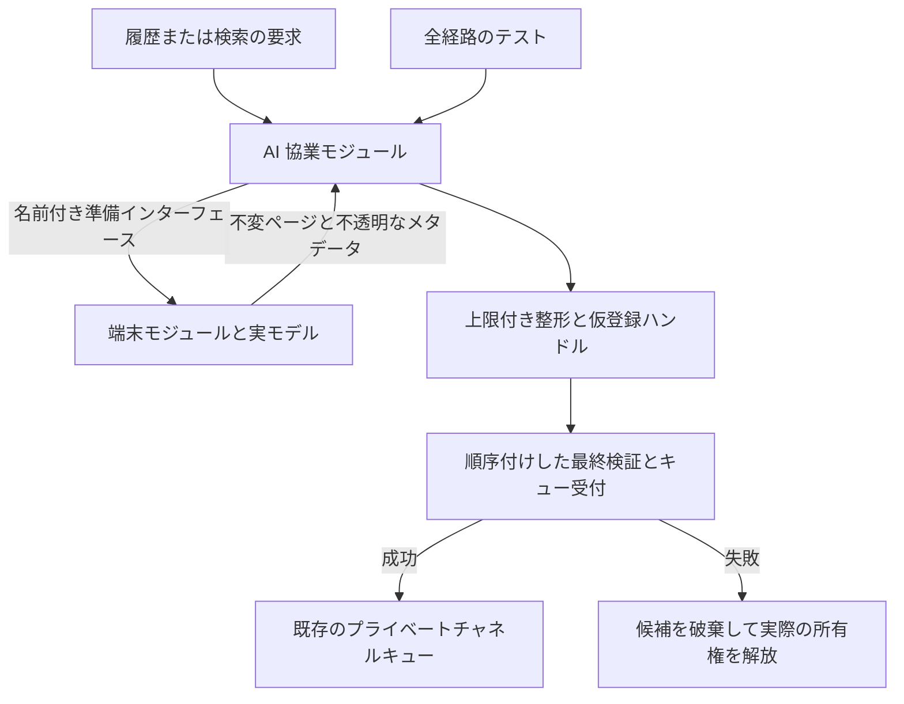

# 保持履歴の観測モジュール設計

2026-11-16 に処理分担を[完全なRust端末設計](native-terminal-core-ja-jp.md)に変更した。現在の分担と検証結果は[実装と検証の状況](implementation-status-ja-jp.md)を参照。

2026-11-14 に設計が承認され、実装準備が完了した。最終認識合わせを含むアーキテクチャ Q12～Q20 は合意済み。この文書は設計上の決定を集約する。リファクタリングとテスト実行は今後の作業。

[アーキテクチャのヒアリング](../drafts/architecture-deepening.md)、[AI 協業の契約](ai-collaboration-ja-jp.md)、[トランスポートの契約](ai-collaboration-transport-ja-jp.md)、[検証計画](ai-collaboration-validation-ja-jp.md)を併せて参照。ADR 0005 の既存セッションを対象とする範囲と、出力共有と入力操作権の分離を維持する。

## 責務とインターフェース

端末モジュールは保持履歴の読み取り、文字列検索、内部範囲とチェックポイントのメタデータ、内容の整合性を所有する。名前付きの読み取りと検索操作の内部に、論理行の同一性、ソフトラップの結合、クラスタ境界、変更と除去の検出、走査範囲を隠す。ADR 0007では、TabTty.Coreのmanaged adapterを通してRustが所有する正本の端末モデルを利用する。端末内容の操作はWPFやMCP JSONに依存せず、端末状態をC#の処理へ移さない。

既存の AI 協業モジュールは連携先の権限、外部識別子、固定のハンドル有効期限、応答の整形、リソース受付、認可された公開を所有する。端末側の準備とこれらの処理を組み合わせる。ツールハンドラーを短くするためだけの中継ファサードは追加しない。

| 責務 | 所有者 |
| --- | --- |
| 上限付き取得、履歴ページ分割、検索、重なりと文脈、内部チェックポイント、リビジョンと保持の検証 | 端末モジュール |
| 連携先、セッション、共有の検査、外部ハンドルのレジストリ、JSON サイズ、公開順序、放棄時の後処理 | AI 協業モジュール |
| プライベートチャネルのキュー受付と実際のバッファー所有権 | 本番公開アダプターと既存トランスポート |
| テストでの制御可能なスケジューリング、時計、キューの受理と拒否 | 同じ公開境界のテストアダプター |

通常の操作インターフェースが準備から公開または放棄までを所有する。ツールハンドラー側で開始、終了、確定、破棄を個別に管理しない。準備したページは不変の内部結果であり、開示には別途権限が必要。変更可能な端末行や、証明を構築する生のコールバックは履歴と検索の呼び出し元に公開しない。

少数の操作の奥に動作を集約し、内容に関する処理を端末モデルと同じ場所に置く。呼び出し元とテストで完全な処理経路を共用する。所有権を取り除くと整合性とライフサイクルの判断がツールハンドラーに分散する。

## 準備と作業量の制限

受付時に連携先、セッション、共有世代、指定された外部範囲または継続を検証する。作業を増やす前に、既存の呼び出し枠、ハンドルの仮登録枠、メモリを予約する。端末側の準備には型付きのオプションと、余裕を持たせた内容および断片の上限を渡す。MCP の直列化データは渡さない。

端末の変更を排除した間に上限付きの不変ウィンドウを取得し、排他の外でバックグラウンド走査する。走査ウィンドウの上限 256 KiB、検索文字列の長さ分を完全なクラスタ境界に丸めた重なり、20 ms の協調的処理区間、呼び出しごとの検索作業予算 100 ms を維持する。作業予算が尽きたら、一致がないページでも検証済みの走査範囲と継続を開示できる。

保持された通常画面のアクティブ画面とスクロールバックを読む。代替画面の背後に退避されている間も対象とする。代替画面の再描画をアーカイブしたり、受信やログの状態を複製したりしない。ソフトラップを結合し、明示的な改行と意味のある空白を保持し、クラスタを分割しない。検索は開始時の固定終端を保持する。ウィンドウをまたぐ一致は開始位置のウィンドウに割り当て、人間側のペインの状態は変更しない。

履歴と検索は上限付きで不透明な内部範囲とチェックポイントのメタデータを使う。チェックポイントや外部ハンドルで行を固定したり履歴全体を凍結したりしない。ページごとに整合性を検査する。連続するページは変化する履歴の一つのアトミックなスナップショットにはならない。

## 応答サイズ

AI 協業モジュールはプライベートチャネルのキューに入れる前に、構造化結果とテキスト結果を合わせた実際の直列化サイズが 1 MiB 以下か確認する。ミラーの JSON エスケープと全結果メタデータを含める。プライベートフレームの 2 MiB 上限も適用する。トランスポート契約に従い、公開側のエンベロープを含むブリッジの結果と公開フレームの防御的検査を維持する。

余裕を持たせた許容枠で整形の失敗を減らし、最後に実サイズを検査する。収まらなければ端末モジュールが上限付きの作業で小さいページを準備する。ページに対応する走査範囲と次のメタデータを選ぶ。整形処理がテキストや一致を黙って捨て、その先に進むことは認めない。JSON フレームの分割や無制限の準備の繰り返しは行わない。リソースが尽きたら進捗を公開せず既存のリソースエラーを返す。準備、走査、再ページ分割は同じ呼び出しの作業予算を共用し、再試行で予算をリセットしない。

実装の容量は最大 256 Unicode スカラー値、UTF-8 で最大 1024 バイトの対応クラスタを収められる必要がある。呼び出し元が明示したテキスト上限が次の完全なクラスタより小さい場合は、進捗なしで resource_limit を返す。上限超過や空の継続の無限発行は行わない。検証済みの走査範囲が進んだ場合の、正当な一致なしの検索継続とは区別する。

## 順序付けした一つの結果としての公開

最終公開前に不変の結果とフレームのバイト列、仮登録する後続 ID、その有効化に必要なリソースを準備する。端末変更を排除する最終区間では、直列化、インデックス構築、データ量に比例する割り当て、外部 I/O を行わない。

1. 端末の排他を保持せず、アプリの権限を順序付ける領域で公開を予定する。権限と元のハンドルの有効性を再検査する。認可エラーで端末のメタデータを明かさない。
2. ディスパッチャーを待たせずに端末の排他取得を試す。競合した場合は排他とディスパッチャーの外で上限付きの再スケジュールを許す。上限に達したら busy を返し、履歴の進捗は公開しない。
3. 端末の変更を排除し、上限付きの内容依存関係と保持情報を検証する。通常の履歴ページと検索の両方が対象。検索では一致のなかった走査領域、重なり、文脈、継続に必要な残りの要求範囲を検証する。
4. キャンセル、最終権限検査、元のハンドルの有効性と固定期限、仮登録枠の有効性の検査を、準備済みフレームの非ブロッキングな受付と順序付ける。この遷移時に同じ単調時計の境界で、再スケジュール後も含め期限を再検査する。以前の検査だけで期限後の公開を許可しない。受付成功時、予約済みで例外を発生させない状態遷移を同じ順序付け領域で行い、仮登録ハンドルと許可されたレジストリへの変更を有効にする。公開済みの後続を、後から来た要求が仮登録のままとして観測できてはならない。
5. 端末の排他をただちに解放する。フレームメモリは実際の解放までキューの所有として計上する。失敗時はこの試行の仮状態を破棄し、各所有者が実際に完了した時点でそれぞれのリソースを解放する。

受付のコールバックは内部用で同期的に実行する。await、直列化、ディスパッチ、ネットワーク I/O、キューの空き待ち、ブロックするロックの取得、端末操作への再入を行えない。遷移の準備で要件を満たせなければ最終排他区間に入る前に拒否または再スケジュールする。

開示の境界はプライベートチャネルのキュー受付。ソケット配信や相手側の受信は境界に含めない。受付より先に順序付けられた権限取り消しやキャンセルは新しいペイロードの開示を阻止する。受付後は確定済みのバイト列を取り戻せない。受付後の失敗で開示済みの進捗を巻き戻さない。内容のエラーは端末の排他の外で整形する。セッション固有の情報を返す前に、アプリの最終権限と元のハンドルの有効性と期限を確認する。条件に該当する場合、準備済みの範囲固有エラーより not_shared と cursor_expired を優先する。

## チェックポイント、識別子、有効期限

履歴と検索の継続は再利用可能な不変チェックポイント。解決しても消費や進行はせず、有効期限も延長しない。再利用では範囲を再検証する。同じ応答や継続して成功することは保証しない。

準備は後続 ID を非公開で仮登録する。公開に失敗しても ID は使用可能にならず、未公開 ID の登録だけを理由に古い有効ハンドルを除去しない。元のハンドルの期限切れ、取り消し、他の受付済み作業による割り当て上限での除去は引き続き適用する。成功する遷移でレジストリ容量と除去計画を検証する。古くなった予約では追加の有効ハンドルを許可しない。

受付成功時、新しい履歴や検索の後続ごとに固定の 60 秒の有効期間を与える。元のハンドルの期限は変えない。連携先ごとに 256 ハンドル、アプリ全体で 4096 ハンドルの共通上限と、最も古いハンドルを除去する既存方針を維持する。外部から使えない仮状態も制限し計上する。

連携先、セッション、取得元との結び付きと既存のエラー優先順を維持する。not_shared はセッションを開示しない。無効または期限切れのハンドルは cursor_expired。認可され検証された範囲だけが range_changed または range_evicted を報告できる。後方に追加しても、変更していない先頭部分は維持される。検索の固定終端より後ろに追加しても検索範囲は広がらない。変更または除去された要求内容を新しい数値位置のテキストで黙って置き換えない。

## 整合性メタデータとメモリの所有権

端末モジュールは、関連する変更と合わせて範囲のリビジョンと保持の集約情報を上限付きで管理する。最終検証は上限付きの参照で行う。公開の排他区間で保持行の全走査、インデックス再構築、無制限の行ごとの証明のコピーは行わない。テキストを元の値に戻しても途中の編集を検出できるようにする。内容のフィンガープリントだけではこの性質を確立できない。再フローだけでは残存コンテンツのアンカーを保持する。必要なメタデータが残る間は除去と編集を区別できる。

端末固有の範囲とインデックス状態は既存の端末状態に計上する。AI 専用に追加する証明、キャッシュ、コピー済みテキスト、仮登録メタデータ、直列化およびキュー内の作業は既存の AI 予算に計上する。共有所有分は一度だけ計上し、所有権の移転で未計上の領域を作らない。アプリ全体の AI 一時作業 64 MiB と、その内数である連携先ごとのトランスポート 8 MiB を維持する。既存の画面スナップショット予算は別にする。

任意の AI メタデータが逼迫した場合は、そのメタデータを期限切れにするか新しい AI 作業を拒否する。端末内容の除去、受信の停滞、検証の弱体化は行わない。証明メタデータが得られなければ既存の明示的な期限切れまたはリソース結果を返す。必要なメタデータを失った場合に履歴の損失範囲を厳密に断定しない。集約インデックスと内部作業量の具体的な数値上限は、既存のリソース上限と応答性の受け入れ条件の範囲内で実装時に決める。

キャンセルは停止を通知する。ワーカーや下層 I/O が使用中のメモリは解放しない。破棄または実際の所有権移転が完了するまで操作が後処理を所有する。入力操作権を返しても閲覧の認可は続く。通常の切断ではタブとともに認可済み履歴を保持できる。再接続、共有終了、連携先の喪失、タブの閉鎖は既存契約に従って該当ハンドルを無効にし、保留作業をキャンセルする。この設計で権限は復元しない。

## 移行と検証

履歴読み取り、検索、継続と、証明構築の処理を AiCollaboration.Observations から端末モジュールへ移す。既存の実モデル、安定したコンテンツアンカー、トランスポート実装を維持する。画面取得、変更待機、入力状態に必要な汎用観測ヘルパーは、履歴で使わなくなっただけでは削除しない。それらの取得期間、レイアウト世代、入力完了の位置情報を保つ。

本番とテストで、実端末モデルを使う同じ準備から公開までのインターフェースを使用する。制御可能な公開、時計、スケジューリングのアダプターで順序を観測する。端末モデルは実モデルを使う。抽出した履歴アルゴリズムの古くなったテストはこのインターフェースでのテストに置き換える。端末、プライベートチャネル、Windows、ホストの個別の検査は維持する。

| シナリオ | 必要な観測 |
| --- | --- |
| 折り返し、日本語、クラスタ、明示的な改行、退避した通常モデル | 人間側のペインを動かさず正しい断片と検索結果を返す。 |
| 変更のない先頭部分に追記、再フロー | 既存の要求内容とアンカーが有効なまま。 |
| 公開前に編集して元のテキストへ戻す | 開示済み進捗を進めず range_changed を返す。 |
| 一致しなかった走査領域、重なり、文脈を編集 | 一致テキストが変わらなくても古いページを拒否する。 |
| 要求内容の除去または証明メタデータの喪失 | 判明した損失またはメタデータの期限切れを正確に報告する。新しい位置に置き換えない。 |
| 受付前の権限取り消し、キャンセル、期限切れ、キュー拒否 | その試行から端末ペイロードや有効な後続は出ず、元のチェックポイントも消費しない。 |
| 満杯のレジストリで仮登録に失敗 | 未公開の後続だけを理由に古い有効ハンドルを除去しない。 |
| 後続の発行に成功して元を再利用 | 元の期限は変わらない。両要求とも範囲と権限の検証を要する。 |
| 直列化上限ちょうどと 1 超過、エスケープの多いテキストとミラー | 収まる完全なページと対応する進捗、または上限付きの明示的な失敗を返す。 |
| 呼び出し元のテキスト上限が一つのクラスタより小さい | 進捗、分割、空の成功ループなしで resource_limit を返す。 |
| 排他の競合、大規模履歴、遅いキュー、キャンセル済みのワーカーや I/O | 試行回数が制限され、リソース所有権が正確で、受信と予約した制御経路の応答性を保つ。 |
| 通常の切断、再接続、共有終了、タブの閉鎖 | 既存のライフサイクル契約が認める保持アクセスだけを維持する。 |

これらは今後の検証要件。ソースレビューでは、実行時の遅延、割り当ての上限、受け入れテストの合格は確認していない。Q20 で最終認識合わせを確認した。この候補の設計上の未決事項はない。実装と実行時検証はアーキテクチャレビューとは別の作業とする。
