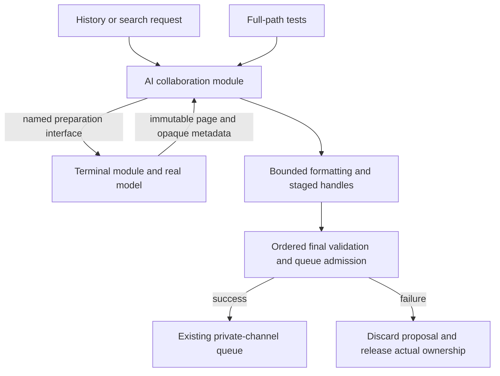

# Retained-history observation module design

Implementation allocation update, 2026-11-16: follow the
[complete Rust terminal design](native-terminal-core.md) for the authoritative
model and terminal-side observation work. The accepted preparation/publication
contract below remains binding. See the [implementation status](implementation-status.md)
for the current allocation and validation.

Status: design accepted and ready for implementation, 2026-11-14. Architecture
Q12-Q20, including the final shared-understanding review, are accepted. This
document consolidates design decisions and does not report an implemented
refactor or executed tests.

Read with the [architecture interview](../drafts/architecture-deepening.md),
[AI collaboration contract](ai-collaboration.md),
[transport contract](ai-collaboration-transport.md), and
[validation plan](ai-collaboration-validation.md). ADR 0005's existing-session
scope and separation of output sharing from input control remain unchanged.

## Responsibility and interface

The terminal module owns retained-history reading, literal search, internal
range/checkpoint metadata, and content consistency. It hides logical-line
identity, soft-wrap joining, cluster boundaries, change/retirement detection,
and scan coverage behind named read and search operations. Under ADR 0007,
TabTty.Core supplies the managed adapter to the authoritative Rust terminal
model; terminal content operations depend on neither WPF nor MCP JSON and
never move terminal state back into a managed reducer.

The existing AI collaboration module owns counterpart permissions, external
identifiers, fixed handle expiry, response formatting, resource admission, and
authorized publication. It combines terminal preparation with these concerns;
do not add a pass-through facade solely to shorten tool handlers.

| Responsibility | Owner |
| --- | --- |
| Bounded capture, history pagination, search, overlap/context, internal checkpoints, revision/retention verification | Terminal module |
| Counterpart/session/sharing checks, external handle registry, JSON sizing, publication ordering, abandonment cleanup | AI collaboration module |
| Private-channel queue admission and actual buffer ownership | Production publication adapter and existing transport |
| Controlled scheduling, clock, queue acceptance/rejection for tests | Test adapters at the same publication seam |

The ordinary operation interface owns preparation through publication or
abandonment. Tool handlers do not manage a separate begin/end/commit/dispose
sequence. Prepared pages are immutable internal results, not permission to
disclose them. Neither mutable terminal rows nor raw proof-building callbacks
are exposed to history/search callers.

This gives depth by concentrating behavior behind a small interface, locality
by keeping content knowledge with the terminal model, and leverage by sharing
the complete path between callers and tests. Deleting this ownership would
spread consistency and lifetime decisions back across tool handlers.

## Preparation and bounded work

Validate the counterpart, session, sharing generation, and any supplied external
range or continuation at admission. Reserve existing invocation, handle-staging,
and memory capacity before growing work. Terminal preparation receives typed
options and conservative content/fragment allowances, not serialized MCP data.

Capture bounded immutable windows while terminal mutation is excluded, then
perform background scanning outside that gate. Preserve the 256 KiB scan-window
limit plus query-length overlap rounded to whole clusters, 20 ms cooperative
slices, and 100 ms search-work budget per call. A no-match page may still disclose
validated coverage and a continuation when that work budget expires.

Read the retained normal active screen and scrollback, including while parked
behind an alternate screen. Do not archive alternate-screen redraws or duplicate
receive/log state. Join soft wraps, preserve hard line endings and meaningful
spaces, and never split clusters. Search retains its initial fixed end, assigns
cross-window matches to their start window, and does not change human pane state.

History and search use bounded opaque internal range/checkpoint metadata.
Neither a checkpoint nor an external handle pins rows or keeps a frozen
transcript. Each page has its own consistency check; successive pages do not
become one atomic snapshot of changing history.

## Response sizing

The AI collaboration module checks the actual combined structured/text result
against the 1 MiB serialized limit before private-channel queue admission.
Include mirrored JSON escaping and all result metadata. Also enforce the
private frame's 2 MiB limit. Preserve the bridge's defensive result and public
frame checks, including the public envelope, under the transport contract.

Conservative allowances reduce failed formatting attempts but are not the final
size check. If the result does not fit, the terminal module prepares a smaller
page within bounded work. It selects matching coverage and successor metadata;
the formatter must not silently drop text or matches while advancing past them.
Do not split JSON frames or repeat preparation indefinitely. Exhausted resource
capacity returns the existing resource error without publishing progress.
Preparation, scanning, and repagination share the original per-call work budget;
retrying does not restart that budget.

Under accepted whole-codebase architecture Q20-Q22/Q25, observations use owned
immutable text and the Rust model's authoritative stored spans from one capture,
generation, projection and range. Retained spellings contain at most their first
256 Unicode scalars; omitted continuations still advance incoming break state
but are not reconstructed in history. Do not re-segment concatenated retained
prefixes, merge VT-separated spans or mix text with metadata from another
capture. Ownership after mutation/disposal does not establish later live
authority or consistency; existing content/retention validation still applies.
See [the terminal contract](terminal-and-encodings.md) and
[the native module](native-terminal-core.md). Candidate 6's final Q23 review was
accepted on 2026-11-18; these are accepted design amendments, not runtime evidence.

Implementation capacity must fit the maximum retained stored span: 256 Unicode
scalars, at most 1024 UTF-8 bytes. This is not a maximum incoming grapheme length
or an outgoing input truncation rule. An explicit caller text limit too small
for the next complete stored span returns resource_limit without progress. Do not
exceed that limit or emit an endless empty continuation. This is distinct from
the legitimate no-match search continuation after advancing validated coverage.

## Publication as one ordered outcome

Prepare immutable result/frame bytes, staged successor IDs, and the resources
needed for their activation before final publication. Serialization, index
construction, proportional allocation, and external I/O do not occur inside
the final terminal mutation gate.

1. Schedule publication in the application's permission-ordering domain without
   holding the terminal gate. Recheck authority and the source handle's validity;
   unauthorized errors must not reveal terminal metadata.
2. Attempt the terminal gate without waiting on the dispatcher. Contention
   permits bounded rescheduling outside the gate and dispatcher. Exhaustion
   returns busy and publishes no history progress.
3. With terminal mutation excluded, verify the bounded content dependencies and
   retention information. Include ordinary history pages as well as search.
   Search verification covers scanned negative areas, overlap, context, and the
   remaining requested range required by continuation.
4. Order cancellation, final permission checks, source-handle validity and fixed
   expiry, and staged registry-reservation validity with nonblocking admission
   of the already prepared frame. Recheck expiry using the same monotonic-clock
   seam at this transition, including after rescheduling; an earlier check does
   not authorize publication past the deadline. A successful admission activates
   staged handles and their permitted registry effects through reserved,
   nonthrowing state transitions in the same ordering domain. No subsequent
   request may observe a published successor as still staged.
5. Release the terminal gate immediately. Queue ownership continues to account
   for frame memory until its actual release. On failure, discard this attempt's
   staged state and release each resource when its owner actually finishes.

The admission callback is internal and synchronous. It cannot await, serialize,
dispatch, perform network I/O, wait for queue space, acquire a blocking lock, or
reenter terminal operations. If preparing the transition cannot satisfy these
requirements, reject or reschedule before entering the final gate.

Private-channel queue acceptance is the disclosure cutoff, not socket delivery
or remote receipt. Revocation or cancellation ordered before that cutoff blocks
new payload disclosure; afterward it cannot recall committed bytes. A failure
after admission does not roll back already disclosed progress. Content errors
are formatted outside the terminal gate and still require the application's
final authority and source-handle validity/expiry checks before any
session-specific information is returned. Preserve not_shared and cursor_expired
precedence over a prepared range-specific error when their conditions apply.

## Checkpoints, identifiers, and expiry

A history/search continuation is a reusable immutable checkpoint. Resolving it
does not consume it, advance it, or renew its expiry. Reusing it revalidates the
range; it does not guarantee an identical response or continued success.

Preparation stages successor IDs privately. Failed publication does not make
them usable or evict older live handles solely to register unpublished IDs.
Source expiry, revocation, and quota retirement caused by other accepted work
still apply. Registry capacity and any eviction plan must be checked for the
successful transition; a stale reservation cannot authorize extra live handles.

On successful admission, each new history/search successor receives its own
fixed 60-second lifetime. The source handle's lifetime is unchanged. Keep the
shared 256-handles-per-counterpart and 4096-handles-per-application limits, with
the existing oldest-handle retirement policy. Staged state is bounded and
accounted even though it is not yet externally usable.

Keep counterpart/session/source binding and existing error precedence:
not_shared does not disclose a session; invalid or expired handles produce
cursor_expired; only an authorized verified range can report range_changed or
range_evicted. An unchanged prefix survives a later suffix append; appends past
a search's fixed end do not extend that search. Changed or evicted requested
content is never silently replaced by text at a newer numeric position.

## Consistency metadata and memory ownership

The terminal module maintains bounded aggregate span-revision and retention
information alongside relevant mutations. Final validation uses bounded
lookups; it does not scan all retained rows, rebuild an index, or copy an
unbounded list of per-line proofs under the publication gate. Intervening edits
remain detectable even if the text is restored to its original value. A content
fingerprint alone does not establish this property. Pure reflow preserves
surviving content anchors; retirement remains distinguishable from editing
when the required metadata is still available.

Charge intrinsic terminal span/index state to existing terminal-state accounting.
Charge additional AI-only proofs, caches, copied text, staged metadata, and
serialized/queued work to existing AI accounting. Shared ownership is counted
once, and ownership transfer does not create a new uncharged pool. Preserve the
64 MiB application AI transient-work cap and its 8 MiB per-counterpart transport
subset, separately from the existing screen-snapshot budget.

Optional AI metadata pressure expires that metadata or rejects new AI work; it
must not evict terminal content, stall reception, or weaken verification.
Unavailable proof metadata produces the existing explicit expiry/resource
outcome. Do not claim exact historical loss when the needed metadata is gone.
The exact aggregate index and numerical internal work caps are implementation
choices within the existing resource limits and responsiveness acceptance gates.

Cancellation signals work to stop but does not free memory still used by a
worker or underlying I/O. The operation owns cleanup until disposal or an actual
ownership transfer completes. Returning input control leaves reading authorized.
Ordinary disconnect may retain authorized history with the tab; reconnect,
sharing end, counterpart loss, and tab close invalidate affected handles and
cancel pending work under the existing contract. No permission is restored by
this design.

## Migration and verification

Move retained-range validation into Rust first. Rust resolves both logical
endpoints, checks the terminating hard line break when the range depends on it,
and combines the partial first and last rows with any whole rows between them.
C# can then drop its validation-specific row search and proof composition.
At publication, validate the range and perform the C# permission checks and
queue admission in the same ordered operation. Move page construction and
literal search into Rust in a later step.

Verify the first step through an existing history range. Appending beyond its
end or changing the wrap width preserves the range. Editing within it and
restoring the original text yields `range_changed`. Retiring the requested
content from scrollback yields `range_evicted`.

Move history reading/search/continuation and their proof-building knowledge out
of AiCollaboration.Observations into the terminal module. Preserve the useful
real model, stable content anchors, and transport implementation. Generic
observation helpers still needed by screen capture, change wait, or input state
must not be removed merely because history stops using them. Preserve their
capture lifetimes, layout epochs, and input-completion watermarks.

Use the same complete preparation/publication interface in production and tests
with the real terminal model. Controlled publication, clock, and scheduling
adapters make ordering observable; they do not substitute a fake terminal model.
Replace obsolete tests of extracted history algorithms with tests at this
interface. Retain distinct terminal, private-channel, Windows, and host checks.

| Scenario | Required observation |
| --- | --- |
| Wrap, Japanese text, clusters, hard lines, parked normal model | Correct fragments and search results without moving human panes. |
| Append to an unchanged prefix; reflow | Existing requested content and anchors remain valid. |
| Edit then restore text before publication | Reject with range_changed, without advancing disclosed progress. |
| Edit a negative scanned region, overlap, or context | Reject the stale page even when matched text itself is unchanged. |
| Retire requested content or lose proof metadata | Report known loss or metadata expiry accurately; never substitute newer positions. |
| Permission revocation, cancellation, expiry, or queue rejection before admission | No terminal payload or live successor from that attempt; source checkpoint is not consumed. |
| Failed staging at a full registry | No older live handle is evicted solely for an unpublished successor. |
| Successful successor; reuse the source | Source expiry is unchanged; both requests still require range and authority validation. |
| Exact serialized limit and one beyond; heavily escaped text and mirror | Produce a fitting complete page and matching progress, or an explicit bounded failure. |
| Caller text limit smaller than one cluster | resource_limit without progress, splitting, or an empty-success loop. |
| Gate contention, large history, slow queue, cancelled worker/I/O | Bounded attempts; accurate resource ownership; reception and reserved control paths remain responsive. |
| Ordinary disconnect, reconnect, sharing end, tab close | Preserve only the retained access allowed by the existing lifetime contract. |

These are future verification requirements. Source review does not establish
latency, bounded allocation in the running implementation, or passing acceptance
tests. Q20 confirms the final shared understanding. No design branch remains
open for this candidate; implementation and runtime verification are separate
work from this architecture review.
