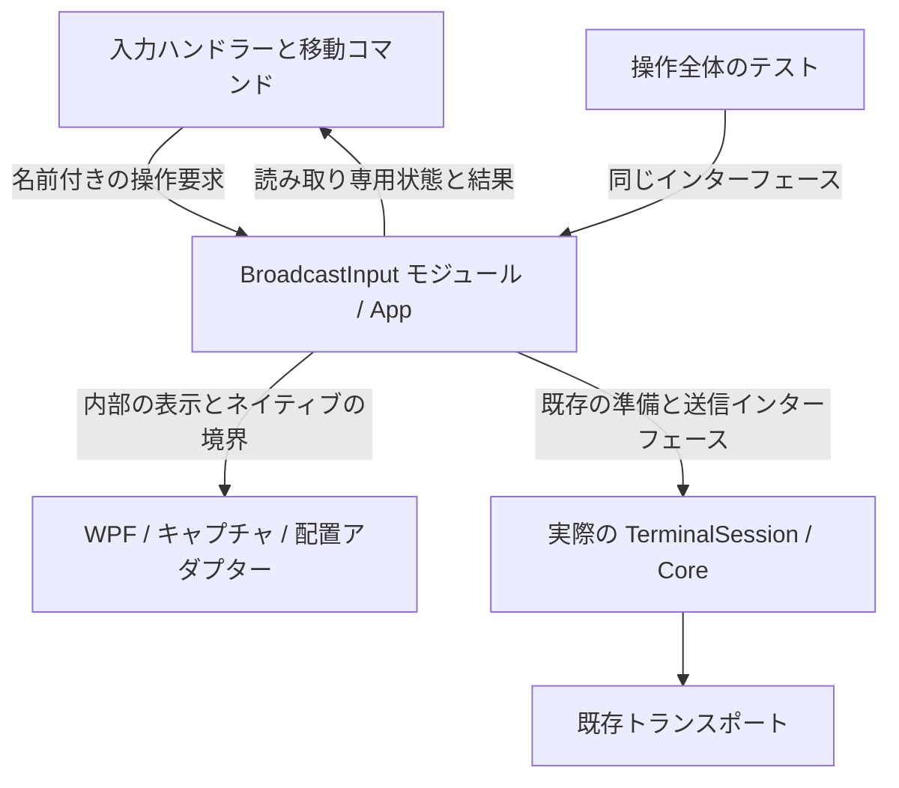

# 同時送信操作モジュールの設計

2026-11-14 に設計が承認され、実装準備が完了した。最終認識合わせを含むアーキテクチャ Q21～Q27 は合意済み。この文書は再構成の提案と検証要件を定義する。リファクタリングとテストは今後の作業。

[アーキテクチャのヒアリング](../drafts/architecture-deepening.md)に決定事項と代替案を記録する。[同時送信と分割の契約](broadcast-and-split-views-ja-jp.md)、[AI 協業の契約](ai-collaboration-ja-jp.md)、[セッションと入力の契約](session-and-recording-ja-jp.md)、[リソース上限](resources-and-validation-ja-jp.md)を併せて参照。ADR 0002 の端末タブごとに一つのセッションと、ADR 0005 の AI の権限と出力共有の規則を維持する。

## 責務と境界

既存の BroadcastInput モジュールは TabTty.App に置く。操作の受付、確定した入力元と送信先の識別情報、プレビューの有効性、実行の調整、キャンセル、後処理の追跡、完了を所有する。範囲、選択、AI 権限、移動の判断は、既存の GUI の順序付けの中に残す。Core に同じ権限判断を重複して作らない。

| 責務 | 所有者 |
| --- | --- |
| 不変のクリップボードテキストの取得、ネイティブ入力のローカルとリモートへの分類、要求された配置先の選択 | 既存の UI 入力とレイアウトのコード |
| モードと選択の方針、操作のライフサイクル、送信先の固定、確認の有効性、進捗と結果、停止、残作業の排出、古い作業の拒否 | BroadcastInput モジュール |
| プレビューの表示と閉鎖、ローカライズ表示、ネイティブキャプチャの観測と実行 | 本番の UI とネイティブアダプター |
| 移動先の準備、取り消し可能な配置、フォーカスとレイアウトの実行、既存の空ウィンドウ閉鎖規則 | アダプター経由の既存配置実装 |
| 送信先ごとの変換、入力の予約、順序付け、一度だけの投入、書き込み、未送信の末尾のキャンセル、エンコーダーとブラケットの終端 | 既存の TerminalSession の入力実装 |
| 決定的なプレビュー、キャプチャ、配置、トランスポートの結果 | 実モジュールと実セッションの入力実装を使う制御可能なアダプター |



モードと選択の状態、実セッションはプロセス内の依存先。既存の制御可能な通信経路がローカルで差し替え可能な境界を提供する。UI、ネイティブ、配置の境界には本番とテストのアダプターを用意する。WPF のイベント引数、ビジュアルツリー走査、ローカライズ表示は要求と状態の値に含めない。

呼び出し元からライフサイクルの調整を取り除き、古い作業と受付の判断を一か所に置く。本番とテストで同じインターフェースを使う。既存のディスパッチ実装を維持し、送信先と順序の方針が呼び出し元へ分散するのを防ぐ。

## 名前付きの操作インターフェース

貼り付け、ネイティブ入力、端末タブの移動全体を名前付きの操作要求として扱い、既存のモード、選択、通常入力のコマンドも使う。正確な名前と C# の内部構成は実装時に決める。呼び出しの例を示す。

```csharp
await broadcast.PasteAsync(sourcePane, immutableClipboardText);
broadcast.ReleaseRemoteButton(observedNativeRelease);
await broadcast.MoveTerminalTabAsync(tab, chosenDestination);
```

呼び出し元は受付と結果の値、不変状態を受け取る。変更可能な Mode/Operation、キャンセルソースは取得せず、操作を完了するための Begin/End の対やハンドル破棄も必要としない。ビューを外したり結果の待機をやめたりしても所有権は解放しない。モジュールは後処理を続け、未完了のアダプターの完了を観測する。

有効な範囲、選択数と準備済み数、選択の可否、操作段階、送信先ごとの進捗と結果、保留中の後処理、コマンドが使えない理由を読み取り専用状態で公開する。観測者は登録時の隙間なしに現在状態と以後の更新を受け取る。進捗はまとめてよいが、完了と後処理状態は観測可能に保つ。観測の解除で取り除くのはそのビューだけ。描画失敗で無関係な操作を完了やキャンセルしない。

型付きの結果は、同時送信が非アクティブ、対象送信先なし、処理中または無効な入力元、キャンセル、配信の完了または失敗を区別する。最初に同時送信が非アクティブと判断した場合だけ既存の単一セッション経路を許す。実行中の同時送信で送信先がゼロ、拒否、失敗の場合は入力元への送信に切り替えない。モード変更をまたいでも操作開始時の経路判断を保持する。

## 受付、準備、プレビュー

すべてのコマンドは GUI の順序付け領域で正規の状態を再検査する。有効なコントロールや以前のスナップショットだけでは実行できない。モーダルダイアログやネイティブイベントで再入し得るアダプターを呼ぶ前に操作の識別と所有権を確立する。回答時に操作と質問の識別を再検証する。UI や複数の送信先を待つ間は端末ロックを保持しない。

実効範囲、不変の入力、入力元の識別と有効期間、対象セッションとその接続世代を確定する。ペイン数にかかわらず各セッションは一度だけ含める。チェックされていない入力元からでも開始でき、選択されている場合だけ入力元にも送る。プレビュー、送信、ジェスチャーの期間中、送信先を固定する。新たにチェックされたタブや送信可能になったタブは参加できない。

モジュールは送信先一覧と間隔フィールドを含む既存の改行付き貼り付け確認を一度要求する。改行がなければ確認しない。UI アダプターは選択を返し、アプリの既定値の変更や送信の開始は行わない。有効な回答の受理と記憶した間隔の更新は、順序付けした一つの遷移とする。既存の 0～10000 ms と起動中だけの設定期間を維持する。遅延した回答やキャンセル済みの回答は状態を変更しない。

ペイロードの受付前に、すべての対象で必要な変換を事前検査し、上限付き入力容量を予約する。対象の一覧を差し替えずに接続世代と準備状態を再確認する。事前検査に失敗したら一切送信しない。対象ごとのエンコーディング、Enter、キーとマウスのモード、エコー、ログの規則と、開始後の障害方針を維持する。

## 停止の受理と操作の完了

モード状態と操作状態は別。**同時送信を終了** はモードを即時終了し、記憶したチェックを保持し、アクティブなチェックボックスを隠し、新しい操作入力の受付を止める。**貼り付けを停止** は対象の貼り付けをキャンセルし、同時送信モードを維持する。どちらの受理も、投入済みバイトの転送が止まったことや必要な後処理の完了を示さない。

影響が発生し始めた後は、受理済みの書き込み、セッションが所有するエンコーダーとブラケットの終端、ネイティブキャプチャとジェスチャーの後処理、予約済みの所有権が実際に終了するか、失敗を記録してリソースを解放するまで、後処理待ち状態を保持する。トークンのキャンセルと期限到達は停止の通知として扱う。既存のトランスポートとプロファイルの期限、キャンセルの挙動を維持する。後処理待ちと、影響を受ける開始や AI への権限付与が利用できない理由を表示する。

プレビューだけのキャンセルでは、閉鎖を要求する前に保留回答、進捗、設定更新の権限を無効にする。未完了のセッション作業やネイティブジェスチャーの所有権がなければ、同時送信の受付と選択の所有権を解放し、ユーザーによる閉鎖や無効な遅延コールバックを待たず完了する。アダプターは残るダイアログやコールバックのリソースを実際の解放まで所有する。実行中の事前検査の予約やネイティブキャプチャは、実際の未完了作業として扱う。

キャンセルと完了を元の操作、セッション世代、確定した範囲に帰属させる。遅延した進捗、キャプチャ喪失、後処理コールバックは、代わりの操作を終了、キャンセル、または消去できない。完了では、送信先ごとに未送信、投入済みまたは到達未確認、失敗の結果を保持し、後処理失敗を明示する。投入で接続先の実行は確認できない。ロールバックや自動再送は追加しない。

## 操作が未完了の間の受付

操作ごとに次の受付条件を維持する。

| 操作 | 規則 |
| --- | --- |
| プレビュー、貼り付け、ボタンジェスチャー中の選択や一括選択 | 合意済みのライフサイクルの規則に従って操作が完了またはキャンセルされるまで固定する。 |
| 貼り付け中の追加同時送信入力 | 既存の貼り付けの規則で拒否する。 |
| ボタンジェスチャー中の通常テキスト | 既存のモードとセッションの順序付けで利用できる。別の貼り付けは拒否する。 |
| 同時送信を終了した後の開始 | 競合する範囲で後処理中なら拒否する。同じローカルウィンドウ、任意の全ウィンドウモードの後処理、全ウィンドウ開始前の任意の後処理が該当する。無関係なローカルウィンドウは利用できる。自動開始をキューに入れない。 |
| 同時送信を終了した後の通常端末入力 | 既存のセッションの受付検査を使う。以前の範囲全体への入力ロックは追加しない。 |
| AI への権限付与 | チェックされていない入力元を含め、入力元とすべての確定済み送信先は未完了の操作全体に結び付く。既存のネイティブ入力、IME、セッションの検査も適用する。個別の送信先に先行して付与したり、後の付与をキューに入れたりしない。 |
| ローカル範囲をまたぐ移動 | 既存の固定操作の規則に従い、両方のアクティブなローカルモードを検査する。同時送信を終了するとそのモードの移動制限は解除される。残作業の排出だけでは制限を延長しない。 |
| 有効範囲内の移動 | 許可済みの同一ウィンドウ内移動と全ウィンドウモードでのウィンドウ間移動を維持し、必要な場合はネイティブの引き継ぎを検証する。 |

プレビューだけを解放しても、無関係な入力、IME、AI 共有、セッションの所有権は上書きしない。共有と選択の排他とアトミックな調整を維持する。AI の入力権限を返しても出力共有の終了や同時送信の選択の復元は行わない。AI ツールの入力は同時送信に分配しない。

## ジェスチャーの識別とネイティブでの引き継ぎ

ネイティブアダプターは観測した入力元の分類、論理端末座標、キャプチャ結果、順序付きの物理イベントを報告する。内部では操作とキャプチャやホストへの所属の識別を分ける。ペインの現在モードだけでは遅延したコールバックを識別できない。

ボタンごとに押下を配信した送信先、報告の世代、最後に有効だった位置、押されているボタン、保留中の解放をモジュール内で保持する。すべてのボタンと必要な解放が解決して初めてジェスチャーは完了する。グリッドと形式の上限、実際のボタン解放時だけの座標制限を維持する。未対応プロトコルで解放を生成せず、対応する押下を受け取っていない送信先や接続または報告の世代が変わった送信先へ解放を送らない。

UI はレイアウトで選んだ移動先とともに一つの完全な移動要求を渡す。モジュールは入力所有権を調整し、配置アダプターはレイアウト方針と実際の変更を担当する。呼び出し元は Active(...).Mouse.Source を読んだり、BeginHostMove/EndHostMove を手動で対にしたりしない。

1. 入力元と移動先の有効性、範囲の制限、配置の受付を再検査する。元ホストが存続している間に移動先を準備する。
2. ネイティブで親を切り替える前に内部の引き継ぎの観測区間を設ける。入力元、セッション、固定した送信先、操作の識別を保持する。
3. 配置とネイティブのアダプターで仮配置とキャプチャの取得を行い、観測したキャプチャと入力の事実を返す。新旧の所属先で観測した同じジェスチャーの実イベントを一度だけ反映する。
4. 旧ホストの終了を確定する前に、検証済みの連続性または明示的なキャンセルを記録する。最後のホストを破棄する前にネイティブキャプチャの所有権を安全に解決する。無関係な未完了の通信後処理で移動制限を追加しない。
5. 配置と今後の選択に対する既存の変更を確定し、既存の空の元ウィンドウの閉鎖を許可する。ウィンドウ間の選択変更は今後の入力だけに影響し、AI 共有中タブの除外を維持する。

キューに入った旧ホストの実際のボタン解放は、移動中のジェスチャーに属することがある。旧ホストの全イベントを拒否しない。重複通知でボタンを二度解放せず、置き換え済み操作のコールバックは後続に影響させない。ネイティブアダプターが連続性を確立できないか、観測の整合を取れなければ明示的にキャンセルし、許可された対応解放の後処理を行う。現在のボタン状態から未観測の解放時刻や位置は復元できない。

配置とジェスチャーの結果は別に扱う。配置が失敗したら元の配置と選択を復元する。キャプチャの連続性を失った場合は、配置を戻せてもジェスチャーのキャンセルを報告する。明示的なジェスチャーキャンセルを伴う配置成功では、ジェスチャーは途切れる。識別情報の管理に加え、Windows のキャプチャ動作はネイティブ検証を行う。

## 所有権、閉鎖、リソース上限

既存の入力予算を維持する。セッションごとの 2 MiB とキュー 256 単位、確定済み貼り付けの 1 MiB 上限、エンコーダーとブラケットの終端用の予約を含む。同時送信の準備と貼り付け以外の既存の期限、プロファイルの貼り付け書き込み時間を維持する。進捗の管理は所有する操作と送信先に限定し、永続的な操作履歴は作らない。

準備済みの予約、バッファー、ネイティブキャプチャ、コールバックのリソースは実際の解放まで計上する。停止、ビューの分離、入力元ウィンドウの閉鎖によって元の所有権を別の操作へ移さない。移動したタブはセッションと操作の識別を維持する。実際にタブを閉じるときは既存の確認、キャンセル、切断、ログ、リソース排出の規則を使う。分割の解除だけで切断しない。

通常の要求はステータスビューが変わっても型付きの完了結果を受け取る。ステータス表示は上限付きの現在状態と既存の結果や詳細画面を使う。所有権の解放に UI の観測は不要。権限を失った遅延コールバックは、完了済み操作を復活させずに自分のリソースの破棄を完了できる。

<a name="migration-and-verification"></a>

## 移行と検証

同時送信プレビューの調整、有効性の検査、進捗の所有権、完了を、TerminalTab が手動で行う BeginPaste/PasteAsync/EndPaste から移す。Q24 でプレビューを無効にしたら、reviewingPaste のような呼び出し元の処理中フラグから同時送信プレビューの影響を除く。応答していない無効なダイアログやコールバックだけで、新しい貼り付けや他の条件を満たす AI 権限付与をブロックしない。独立した単一セッションのプレビュー、IME、ネイティブキャプチャ、保留送信、実際の事前検査予約の検査を維持する。呼び出し元から変更可能なモードと操作の状態、キャッシュ済みのジェスチャーモードの選択へのアクセスを除く。MainWindow が手動で管理する同時送信キャプチャの開始と終了を、名前付き移動要求と配置アダプターで置き換える。通常の単一セッション入力、ネイティブ入力元の分類、レイアウト方針、既存の Core の書き込み処理を維持する。

本番とテストで、制御可能な通信経路と実 TerminalSession を使い、操作インターフェース全体を通す。確認、スケジューリング、キャプチャ、配置の制御可能なアダプターで遅延回答と引き継ぎの順序を決定的にする。非公開のライフサイクルを手動で組み立てる旧テストをこの検証に置き換える。補完する WPF 統合と Windows のネイティブキャプチャ、ドラッグ＆ドロップ、DPI、IME、アクセシビリティの検査を維持する。

| ケース | 必要な観測結果 |
| --- | --- |
| B01 完全な貼り付け | 入力元、テキスト、送信先を取得し、必要なプレビューを一度表示し、全送信先を事前検査する。通常インターフェースで進捗と実際の完了を報告する。 |
| B02 キャンセル済みプレビュー | 無効なコールバックが未完了でも受付を解放し、他の条件を満たす新しい貼り付けを許可し、閉鎖を要求する。遅い承認や既定値更新を無視し、無効なリソースも解放までは保持する。 |
| B03 送信後の停止 | 速やかに受理し、後処理待ちを表示する。実際の完了まで入力とネイティブの所有権を保持し、貼り付け停止と同時送信終了を区別する。 |
| B04 受付条件 | 競合する開始と無関係な開始、ローカルと全ウィンドウでの開始、終了後の通常入力、ジェスチャー中のテキスト、チェックされていない入力元を含む操作全体の AI 排他を試す。 |
| B05 固定送信先と事前検査 | 後からの参加、ペイン間の重複配信、対象ゼロでの入力元へのフォールバック、変換や事前検査失敗時の送信、再接続後の転送先の差し替えが発生しない。 |
| B06 トランスポートとキャンセルの競合 | 遅延書き込み、終端失敗、期限切れでも実際の予約を維持し、再送や早すぎる完了なしで不確実性や失敗を報告する。 |
| B07 ジェスチャー | ボタンの重複、グリッドからの退出と再進入、報告世代、ネイティブキャプチャの失敗や喪失、必要な最後の解放は既存のマウス契約に従う。 |
| B08 古いネイティブ作業 | 元の操作の遅延した喪失や進捗が代わりの操作をキャンセルや消去しない。同じ引き継ぎ中の旧ホストでの実際の解放は一度だけ反映する。 |
| B09 移動結果 | 許可された移動とアクティブなローカル制限を維持する。同時送信終了後の排出中には制限を追加しない。配置の失敗とロールバックをジェスチャーのキャンセルと区別する。 |
| B10 ホストの終了 | 最終タブの移動、入力元の移動、キャプチャの不確実性では、引き継ぎやキャンセルの判断とネイティブの安全な終了まで所有権を保持する。通信の後処理は追跡し続ける。 |
| B11 AI との調整 | 共有、選択、移動、権限付与の順序付き排他と、チェックされていない入力元の所有権を保持する。プレビューだけのキャンセル後は無効なコールバックだけで他の条件を満たす権限付与を阻止しない。独立した入力、IME、キャプチャ、事前検査の所有権による阻止は続く。 |
| B12 観測者とリソース | ビューの分離、遅延ダイアログコールバック、まとめた進捗、閉鎖または移動したホストによって後処理の所有権が失われたり代替状態が変わったりせず、予算を維持する。 |

独立したソースと文書の整合性レビューでは、最終確認以外に重要な未決事項は見つからなかった。キャンセル済みプレビューの旧処理中フラグと B02/B11 の検証範囲を明確にした。新たな決定を加えず、合意済みの Q24 に従う。

これらは今後の検査であり、ソースレビューだけでネイティブ引き継ぎの正しさ、実測した応答性、テスト合格は確定しない。Q27 で最終認識合わせを確認した。設計上の未決事項はなく、この候補の実装準備は完了した。ユーザーはチケットの準備を依頼した。
