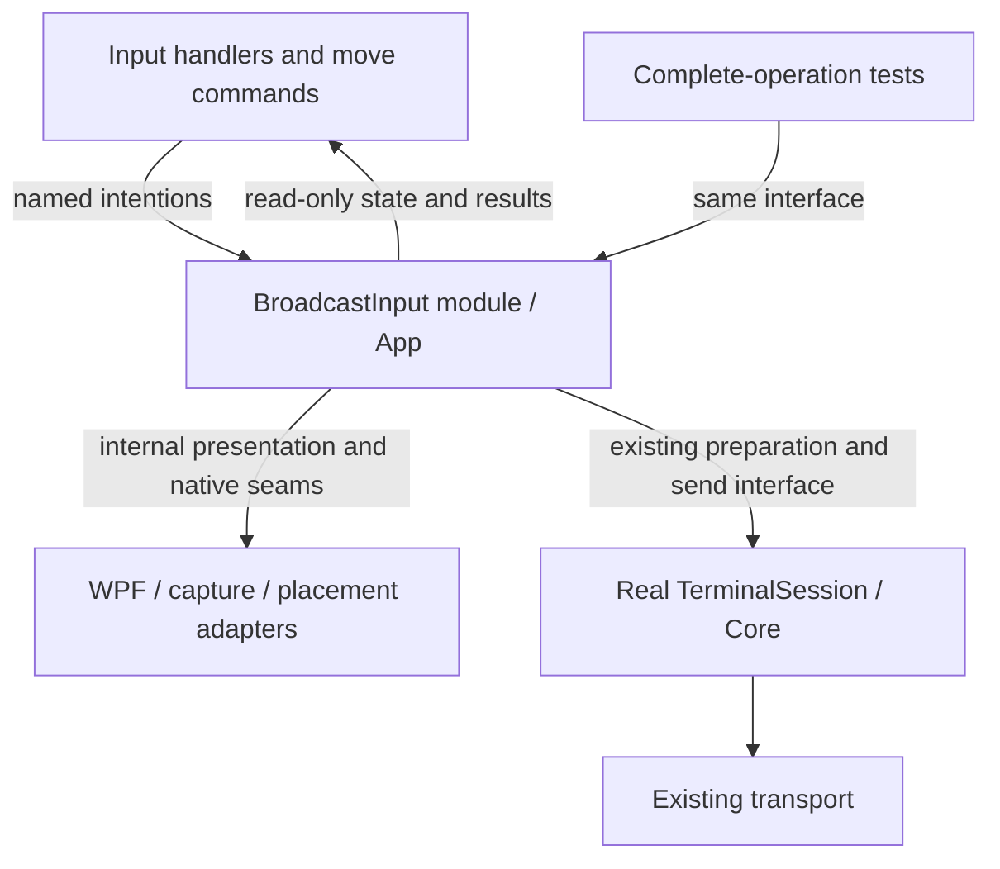

# Broadcast-input operation module design

Status: design accepted and ready for implementation, 2026-11-14. Architecture
Q21-Q27, including final shared understanding, are accepted. This document
defines the proposed restructuring and its verification requirements. It reports
no implemented refactor or executed tests.

The [architecture interview](../drafts/architecture-deepening.md) records the
decisions and alternatives. Read with the
[broadcast/split contract](broadcast-and-split-views.md),
[AI collaboration contract](ai-collaboration.md),
[session/input contract](session-and-recording.md), and
[resource limits](resources-and-validation.md). Preserve ADR 0002's one session
per terminal tab and ADR 0005's AI authority and output-sharing rules.

## Responsibility and seams

Keep the existing BroadcastInput module in TabTty.App. It owns operation
admission, captured source/recipient identities, preview validity, execution
coordination, cancellation, cleanup tracking, and completion. Scope, selection,
AI permissions, and movement decisions remain in the existing ordered GUI
coordination. Do not create another copy of that authority in Core.

| Responsibility | Owner |
| --- | --- |
| Capture immutable clipboard text; classify local/remote native input; choose the requested layout destination | Existing UI input and layout code |
| Mode/selection policy, operation lifetime, recipient freezing, confirmation validity, progress/results, Stop, draining, stale-work rejection | BroadcastInput module |
| Preview display/closure, localized rendering, native capture observations and execution | Production UI/native adapters |
| Destination preparation, reversible placement, focus/layout execution, and existing empty-window closure rule | Existing placement implementation through its adapter |
| Per-target conversion, input reservation, ordering, once-only submission, writes, unsent-tail cancellation, encoder/bracket closure | Existing TerminalSession input implementation |
| Deterministic preview, capture, placement, and transport outcomes | Controlled adapters using the real module and session input implementation |



Mode/selection state and real sessions are in-process dependencies. The
existing controlled wire provides the local-substitutable seam. UI/native and
placement seams have both production and test adapters. Keep WPF event arguments,
visual-tree traversal, and localized presentation out of request/state values.

This gives depth by removing lifetime choreography from callers, locality by
keeping stale-work and admission decisions together, and leverage through a
shared production/test interface. Retain the useful dispatch implementation;
deleting it would spread recipient and ordering policy back into callers.

## Named operation interface

Use named paste, native-input, and complete terminal-tab move intentions, plus
the existing mode, selection, and ordinary-input commands. Exact names and
internal C# decomposition are implementation choices. Illustrative calls are:

```csharp
await broadcast.PasteAsync(sourcePane, immutableClipboardText);
broadcast.ReleaseRemoteButton(observedNativeRelease);
await broadcast.MoveTerminalTabAsync(tab, chosenDestination);
```

Callers receive admission/outcome values and immutable state. They never acquire
mutable Mode/Operation objects, cancellation sources, or an obligation to pair
Begin/End or dispose a handle to finish an operation. Dropping a view or ceasing
to await a result does not release operation ownership. The module continues
cleanup and observes outstanding adapter completions.

Expose effective scope, selected/ready counts, selection availability, operation
phase, per-target progress/outcomes, pending cleanup, and reasons commands are
unavailable through read-only state. Observers receive current state and later
updates without a registration gap. Progress may coalesce, but completion and
cleanup state must remain observable. Detaching an observer only removes that
view. Rendering failure does not complete or cancel an unrelated operation.

Typed outcomes distinguish inactive broadcast, no eligible recipients, busy or
invalid source, cancellation, and completed/failed delivery. Only an initial
inactive-broadcast decision permits the existing single-session path. Active
broadcast with zero recipients, rejection, or failure never falls back to sending
to the source. Preserve a gesture's initial routing decision across mode changes.

## Admission, preparation, and preview

Every command rechecks authoritative state in the GUI ordering domain; an
enabled control or earlier snapshot does not authorize execution. Establish
operation identity and ownership before calling an adapter that may reenter
through a modal dialog or native event. Revalidate operation/question identity
when that adapter answers. Do not hold terminal locks while awaiting UI or
multiple recipients.

Capture the effective scope, immutable input, source identity/lifetime, and
eligible recipient sessions with their connection generations. A session is
included once regardless of pane count. An unchecked source can originate input
but receives it only if selected. Preserve the fixed recipient set through
preview, sending, and gesture lifetime; newly checked or ready tabs cannot join.

The module requests the existing single required newline confirmation, with
target list and pacing fields. No-newline paste retains its no-confirmation
rule. The UI adapter returns a choice; it does not change application defaults
or start sending itself. Accepting a valid answer and updating remembered pacing
is one ordered transition. Keep the existing 0-10000 ms values and application-
run-only preference lifetime. Late or already-cancelled answers change nothing.

Before any payload is admitted, preflight every required target conversion and
reserve its bounded input capacity. Recheck connection generation/readiness
without substituting a changed target list. Preflight failure sends none of the
operation. Keep all existing per-target encoding, Enter/key/mouse modes, echo,
and logging rules, and the current post-start failure policy.

## Stop acknowledgement and operation completion

Mode state and operation state are separate. Full Stop ends the active mode
immediately, preserves remembered checks, hides its active checkboxes, and
prevents further operation input admission. Stop Paste cancels that paste and
leaves broadcast mode active. Neither acknowledgement proves that submitted
bytes have stopped travelling or that required cleanup has finished.

After effects start, retain cleanup-pending state until admitted writes,
session-owned encoder/bracket closure, native capture/gesture cleanup, and
reserved ownership have actually ended or concluded with a recorded failure
and released their resources. Cancelling a token or reaching a deadline is a
signal to stop, not proof of completion. Keep the existing transport/profile
deadlines and cancellation semantics. Display pending cleanup and the reason
an affected Start or AI grant is unavailable.

Preview-only cancellation invalidates the pending answer, progress, and
preference-update authority before requesting the preview's closure. With no
session work or native gesture ownership outstanding, release broadcast
admission/selection ownership and complete without waiting for a user dismissal
or inert late callback. The adapter still owns any remaining dialog/callback
resources until actual release. Active preflight reservations or native capture
are real outstanding work, not inert preview resources.

Keep cancellation and completion attributed to the original operation,
session generations, and captured scope. A late progress, capture-loss, or
cleanup callback cannot finish, cancel, or clear the state of a replacement
operation. Completion preserves per-target not-sent, submitted/possibly-delivered,
and failed outcomes, with cleanup failure explicitly represented. Submission
does not prove remote execution; no rollback or automatic replay is added.

## Admission while operations are unfinished

Preserve these distinct gates rather than deriving every decision from one
generic busy flag:

| Action | Rule |
| --- | --- |
| Selection/bulk selection during preview, paste, or button gesture | Frozen until the relevant operation completes/cancels under the accepted lifetime rules. |
| Additional broadcast input during paste | Rejected under the existing paste rule. |
| Ordinary text during a button gesture | Remains available through existing mode/session ordering; another paste is rejected. |
| Start after full Stop | Reject while a conflicting scope is draining: same local window, any draining global mode, or any drain before global Start. Unrelated local windows remain available. Do not queue automatic Start. |
| Ordinary terminal input after full Stop | Uses its existing session admission checks; no whole-old-scope input lock is introduced. |
| AI grant | Source and all captured targets remain associated with the whole unfinished operation, including an unchecked source. Existing native input/IME and session checks also apply. Do not grant individual targets early or queue a future grant. |
| Movement across a local scope | Check both active local modes under the existing frozen-operation rule. Full Stop removes that mode's movement barrier; draining alone does not extend it. |
| Movement within the effective scope | Preserve allowed local same-window and global cross-window moves and verify native handoff where required. |

Preview-only release does not override unrelated input, IME, AI-sharing, or
session ownership. Preserve sharing/selection exclusions and their atomic
coordination. Returning AI input control does not end output sharing or restore
broadcast selection. AI tool input never enters broadcast fan-out.

## Gesture identity and native handoff

Native adapters report observed source classification, logical terminal
coordinates, capture results, and ordered physical events. Maintain distinct
operation and capture/host-attachment identity internally. A pane's current
mode is not enough to identify a delayed callback.

Keep per-button delivered-press recipients, reporting generations, last valid
positions, held buttons, and pending releases inside the module. A gesture
completes only after all buttons and required release work are resolved.
Preserve grid/format bounds, actual-up release clamping, no fabricated releases
for unsupported protocols, and no release to a target that never received the
matching press or now has a different connection/reporting generation.

The UI submits one complete move intent with the layout-selected destination.
The module coordinates input ownership; the placement adapter retains layout
policy and actual mutation. No caller reads Active(...).Mouse.Source or manually
pairs BeginHostMove/EndHostMove to keep the gesture valid.

1. Recheck source/destination validity, scope barriers, and placement admission.
   Prepare the destination while the original host remains alive.
2. Establish an internal handoff observation interval before native reparenting.
   Preserve the source, sessions, frozen targets, and operation identity.
3. Let the placement/native adapters execute provisional placement and capture
   acquisition, and return observed capture and input facts. Reconcile genuine
   same-gesture events from the old and new attachments exactly once.
4. Record verified continuity or explicit cancellation before finalizing host
   retirement. Native capture ownership must be safely resolved before disposing
   its last host. Unrelated outstanding wire cleanup adds no new move barrier.
5. Finalize placement and existing future-selection changes, then allow the
   existing empty-source-window closure. Cross-window selection changes affect
   future input only and preserve the AI-shared-tab exclusion.

A queued actual button-up from the old host may still belong to the moving
gesture. Do not reject every old-host event. Duplicate notifications cannot
release a button twice; callbacks for a replaced operation cannot affect its
successor. If the native adapter cannot establish continuity or reconcile the
observations, explicitly cancel and perform permitted matching-release cleanup.
Current button state cannot reconstruct an unobserved release's time/location.

Placement outcome and gesture outcome are separate. Placement failure restores
the original placement and selection; if capture continuity was lost, report
gesture cancellation even when layout rollback succeeds. Successful placement
with explicit gesture cancellation is not uninterrupted gesture transfer. These
requirements do not claim that identity bookkeeping proves Windows capture
correctness; native validation remains necessary.

## Ownership, closure, and bounded resources

Retain the existing input budgets, including 2 MiB and 256 queue units per
session, the 1 MiB finalized paste limit, and reserved encoder/bracket closure
capacity. Keep existing broadcast preparation/non-paste deadlines and profile
paste-write timing. Progress bookkeeping is bounded to owned operations and
targets; this design does not create a persistent operation-history store.

Prepared reservations, buffers, native capture, and callback resources remain
charged until actual release. Neither Stop, view detachment, nor a closed source
window transfers old ownership to a replacement operation. A moved tab retains
its session and operation identity; actual tab closure uses the existing
confirmation, cancellation, disconnect, logging, and resource-drain rules.
Split removal alone does not disconnect a session.

The ordinary request receives its typed completion result even when the status
view changes. Status presentation uses bounded current state and the existing
result/detail surface. UI observation is not required to release ownership.
Late callbacks with no remaining authority may finish disposing their own
resources without reviving the completed operation.

## Migration and verification

Move broadcast preview orchestration, validity checks, progress ownership, and
completion out of TerminalTab's manual BeginPaste/PasteAsync/EndPaste sequence.
Retire the broadcast preview's contribution to caller-side busy flags such as
reviewingPaste when Q24 invalidates that preview. An inert dialog or callback
that has not returned must not block a replacement paste or an otherwise
eligible AI grant. Preserve independent single-session preview, IME, native
capture, pending sends, and real preflight reservation checks.
Remove caller access to mutable mode/operation state and cached gesture-mode
selection. Replace MainWindow's manual broadcast capture lifetime pairing with
the named move intention and placement adapter. Preserve ordinary single-session
input, native source classification, layout policy, and the existing Core writer.

Production and tests exercise the complete operation interface using the real
TerminalSession with the controlled wire. Controlled confirmation, scheduling,
capture, and placement adapters make delayed answers and handoff ordering
deterministic. Replace superseded tests that construct the private lifecycle
manually with this coverage. Keep complementary WPF integration and native
Windows capture/drag-and-drop/DPI/IME/accessibility checks.

| Case | Required observable result |
| --- | --- |
| B01: complete paste | Capture source/text/targets, show one required preview, preflight all recipients, report progress and actual completion through the ordinary interface. |
| B02: cancelled preview | While its inert callback remains outstanding, release operation admission, permit an otherwise valid replacement paste, request closure, and ignore later acceptance/defaults updates; retain inert resources until released. |
| B03: Stop after sending | Acknowledge promptly, show pending cleanup, retain input/native ownership until actual completion, and distinguish Stop Paste from full Stop. |
| B04: admission gates | Test conflicting and unrelated local/global Starts, ordinary input after Stop, text during gestures, and whole-operation AI exclusion including unchecked sources. |
| B05: frozen targets and preflight | No late joins, no duplicate delivery across panes, no source fallback for zero targets, no payload on conversion/preflight failure, no redirection after reconnect. |
| B06: transport/cancellation race | Delayed writes, closure failure, and deadline expiry retain actual reservations; report uncertainty/failure without replay or premature completion. |
| B07: gestures | Overlapping buttons, grid exit/re-entry, reporting generations, native capture failure/loss, and required final releases follow the existing mouse contract. |
| B08: stale native work | An old operation's delayed loss/progress cannot cancel or clear its replacement; a genuine old-host release during the same handoff is accounted exactly once. |
| B09: move outcomes | Preserve allowed moves and active local barriers; after full Stop do not add a draining barrier. Distinguish placement failure/rollback from gesture cancellation. |
| B10: host retirement | Last-tab transfer, source movement, and capture uncertainty retain ownership until handoff/cancellation decision and safe native retirement; ongoing wire cleanup remains tracked. |
| B11: AI coordination | Preserve ordered sharing/selection/move/grant exclusions and unchecked-source ownership. After preview-only cancellation, an inert callback alone cannot block an otherwise eligible grant; independent input/IME/capture/preflight ownership still blocks it. |
| B12: observers and resources | View detachment, late dialog callbacks, coalesced progress, and closed/moved hosts cannot lose cleanup ownership or mutate replacement state; budgets remain bounded. |

Independent source/document consistency review found no material design branch
beyond final confirmation. It clarified the cancelled preview's legacy busy
flags and B02/B11 coverage; this follows accepted Q24 without a new decision.

These are future checks, not results. Source review does not establish native
handoff correctness, measured responsiveness, or passing tests. Q27 confirms
the final shared understanding. No design branch remains open; this candidate
is ready for implementation as a design, and the user requested ticket preparation.
