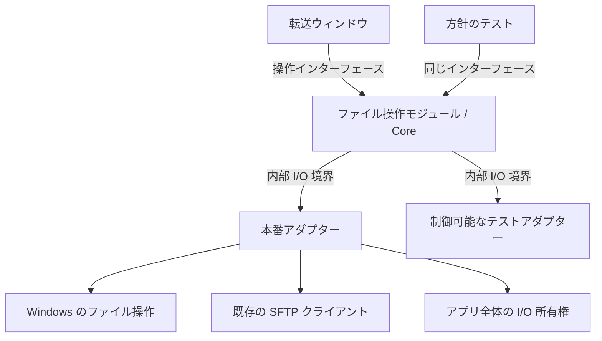

# ファイル操作モジュールの設計

2026-11-14 に設計が承認され、実装準備が完了した。最終認識合わせを含むアーキテクチャのヒアリング Q1～Q11 は合意済み。実装と試作には別途、ユーザーからの明示的な依頼が必要。この集約で実装テストは実行していない。

[アーキテクチャのヒアリング](../drafts/architecture-deepening.md)に決定事項と代替案を記録する。[SFTP ファイル転送の契約](file-transfer-ja-jp.md)は、引き続きファイルの動作、確認の選択肢、パスの扱い、上限、トランスポートの要件を定義する。この文書では、Q8～Q10 の受付と保持に関する決定を含め、責務とライフサイクルを定義する。

## 責務と境界

`TabTty.Core` のファイル操作モジュールがコピー、アップロード、ダウンロード、削除、名前変更、フォルダー作成を所有する。実装は WPF から独立し、転送ウィンドウとテストは同じインターフェースを使う。コピーと削除はモジュール内で個別のアルゴリズムを維持する。

内部境界では本番とテストのいずれか一方のアダプターを使う。

| 責務 | 所有者 |
| --- | --- |
| 閲覧、選択、パスと名前の入力、ドラッグの妥当性、ダイアログ、ローカライズした表示 | 転送ウィンドウと表示アダプター |
| 受付、確定した要求、事前検査、確認の有効性、実行、キャンセル、結果、再試行の選択 | ファイル操作モジュール |
| Windows の操作、転送元と転送先の属性と同一性の検査、ファイルデータ、ネイティブのごみ箱への移動、低レベルの完了事実 | `TransferFiles` の既存ロジックを再利用する本番 I/O アダプター |
| SFTP のフレーミング、要求への応答、チャネルの識別、トランスポートのフロー制御と閉鎖 | 既存の SFTP/SSH 実装 |
| 未完了 I/O の所有権、ウィンドウ間で共有するリソースと直列化のライフサイクル | アプリ全体の I/O 管理。UI コントロールへの参照を持たない。 |
| スクリプトで指定した I/O の完了、失敗、対象の変更、遅延完了 | 制御可能なテストアダプター |

外部境界にはファイル操作と観測可能な結果を公開する。再帰アルゴリズムや変更可能な実行状態は内部に置く。呼び出し元は少数の操作で複雑な処理を利用でき、方針の変更と検証を一か所に集められる。既存の I/O ロジックは内部境界の奥に維持し、呼び出し元に処理を分散させない。

## 操作インターフェース

コピー、削除、名前変更、フォルダー作成には名前付きの操作を使う。操作の識別情報は不透明とし、モジュールが所有する。正確な C# 名と内部の分割は実装時に決める。読み取り専用状態の観測、確認要求への回答、キャンセル要求、対象となる失敗した転送項目の再試行、閉じる決定後の操作コンテキストの閉鎖もサポートする。

操作要求は選択項目と転送先または名前を、上限のある安定した値として確定する。接続先の生の名前バイト列と選択したパス情報を保持する。以後の閲覧で操作の対象を変えない。取得済み属性があっても、必要な最新状態の再検査を行う。

受付はモジュールが判断する。ボタンの無効化はその判断を表示する。接続が使えない、別操作が実行中、Q8/Q10 が変更を禁止する、必要な容量がない場合は開始を拒否する。開始が拒否されても最新の結果は消さない。既存の即時受付方式を維持し、将来の操作を待たせるキューは加えない。

読み取り専用状態は所有モジュールと操作を識別し、受付、進捗、保留中の確認、項目ごとの結果、再試行の可否、未完了 I/O または後処理を表す。観測は現在の状態から始める。進捗更新はまとめてよいが、保留中の質問と保持済み結果は引き続き観測可能にする。表示側のディスパッチは分離済みビューや古い所有者へのコールバックを破棄する。観測を解除しただけではキャンセルを要求しない。

通常の拒否とファイル操作の失敗は観測可能な結果を返す。受付から成功を、キャンセルから影響がないことを推定してはならない。モジュール自身が実行の管理を完了する。受付の解放に呼び出し側の `End` 呼び出しや操作ハンドルの破棄は不要。論理操作の完了と実際の I/O の完了は別に扱う。

## 確認とキャンセル

既存の最初の削除、上書き、完全削除への切り替えに確認が必要か、モジュールが判断する。質問に必要な事実と許可する選択肢を渡す。ダイアログとロケールリソースは表示アダプターが所有する。名前と内部識別子は翻訳済みテキストに依存しない。

保留中の質問は一つの接続上の一つの操作に属する。現在の質問への回答だけが次の処理を許可できる。キャンセル、切断、承認済みの閉鎖は質問を無効にする。遅延または重複した回答では作業を許可しない。ダイアログ待機中も無効化を可能にし、ローカルでのユーザー入力待ちを既存の I/O 期限に含めない。

有効な回答の後、転送の契約に従って対象を再検査する。対象に変化があれば、上書きの判断を改めて求める。応答の失敗や欠落を承認とみなさない。ごみ箱への移動に失敗した場合、切り替えが有効なときだけ規定の完全削除を確認できる。ごみ箱への移動の結果が不明な場合、二度目の破壊的操作は認めない。

キャンセルは新しい作業を止め、確認済みの影響と必要な後処理を維持する。発行済み I/O の所有者は変わらない。項目ごとに完了、スキップ、失敗、未処理、不明を区別する。変更応答を失うと結果が不明になる場合がある。不確かな確定は再送せず、後処理として最終パスを削除しない。後処理を確認できなければ未解決の一時パスを保持する。

キャンセル済みの作業に未完了 I/O がある間、該当接続の転送ウィンドウは別の変更を受け付けない。閲覧と閉鎖は使えるが、閲覧コントロールが有効でも停滞中のプロバイダーの応答は保証しない。I/O の終了後、追加の変更を受け付ける前に契約で求める更新と再検査を行う。UI の更新だけでは未完了 I/O は終了しない。

## 結果と再試行

最新の一操作について、上限付きの結果と再試行可能な項目のメタデータを保持する。次の操作を受け付けたときだけ両方を置き換える。容量不足を含め開始を拒否した場合は両方を保持する。転送ウィンドウを閉じると表示用の結果と再試行メタデータを破棄し、開き直しても操作履歴は復元しない。切断後も開いているウィンドウは結果を保持する。

再試行では、元の接続が有効な間にモジュールが保持した失敗済み転送項目を使い、現在の転送元、転送先、衝突を最初から検査する。結果が不明な項目は通常の失敗として自動再送しない。既存の再試行範囲を維持する。モジュールを共有しても作成、名前変更、削除は再実行の対象にしない。

項目ごとの結果、理由、パスの事実、メタデータや後処理の警告は表示文字列から独立させる。計画、結果、再試行の保存には既存の項目数、パス、メモリ上限を共用する。容量不足や省略した詳細を明示する。無制限のイベント履歴は保持しない。表示上の保持期間によって未完了 I/O の所有権の解放時期を決めない。

直近に受理した操作では、未解決の結果と判明しているパスを優先して保持する。容量が逼迫したら、まず成功などの通常明細を省略し、その旨を表示する。転送先に一時ファイルを作る前に、削除を確認できなかった場合でも既存の上限内でそのパスを保持できることを確かめる。容量がなお不足する場合は、そのファイルへの書き込みを始める前に容量不足を報告する。それまでに保持した未解決の明細も残す。

## 接続、ウィンドウ、リソースのライフサイクル

各操作コンテキストを端末セッションの現在の接続に結び付ける。タブを移動しても再接続や置き換えは行わず、表示上の所属だけを変更する。再接続後に明示的に転送を開くと新しいモジュールと接続を使う。古い回答、進捗、結果、再試行状態は引き継がない。

既存の閉鎖確認の後、質問を無効にして作業を止める。既存の上限付き終了方針を適用し、判明している未解決のパスや結果を閉じる前に表示する。ビューを閉じると表示上の関連付けを解放する。存在する I/O の所有権は維持する。

閉じる前の報告には、未解決の結果を種類別に集計した件数と、全種類を合わせた先頭10件の明細を表示する。利用者は閉じる前に、同じ報告から残りの全明細と判明しているパスを確認できる。転送ウィンドウを直接閉じる場合も、端末タブと一緒に閉じる場合も、直近の操作が保持する同じ未解決結果を使う。

アプリ全体の管理は実際の完了まで、I/O の元の接続と操作、完了の追跡、プロバイダーの予約、必要な変更の直列化を保持する。同じ接続でビューを開き直すと所有権を確認し、受付制限を引き継ぐ。新しい接続に新しい操作モジュールを割り当てても、古い I/O の予約やローカルの直列化は解放しない。遅延完了で元の作業を終了できる。別の操作を完了したり古い接続を再有効化したりはできない。

共有の転送バッチ 4 件の上限とローカルプロバイダー呼び出し 8 件の上限は別にする。作成、名前変更、削除には、アプリ全体の 4 バッチの制限を追加適用しない。ローカルプロバイダーの呼び出しは実際に復帰するまで計上する。必要なローカル変更の直列化は待機タスクではなく I/O の実際の有効期間に従う。契約で定める、タブをまたいだ同一の解決済み転送先への変更も対象とする。

この所有権で外部の書き込み元をロックしたり、SFTP ファイルシステムのスナップショットを提供したりはできない。古い接続先要求の識別情報は既存のチャネル閉鎖規則に従って無効にする。最終終了時は既存の上限付き待機とバックグラウンドに残らない方針を維持する。永続的な後処理、操作の復元、終了時の外部への影響がすべて完了したことの保証は追加しない。

## 内部 I/O 契約と検証

内部境界は実際の属性、同一性、データ、実行結果を本番の方針モジュールへ渡す。アダプターは未発行、完了または失敗の確認済み、影響が未確認の作業を区別する。未完了のプロバイダー所有権を実際に終了できる時点も公開する。待機のキャンセルで確認済みの失敗を作ったり、プロバイダーが使用中のリソースを解放したりできない。承認と再試行の判断は方針モジュールに置き、各アダプターで重複実装しない。

制御可能なアダプターで属性変更、失敗、応答喪失、遅延完了をスケジュールする。期限が関わる場合は時間を制御し、実時間の競合に依存しないテストにする。ウィンドウと同じ名前付き操作、観測、回答、キャンセルで実モジュールを検査する。

| 必須の検査 | 観測可能な結果 |
| --- | --- |
| 子の削除が失敗 | 完了済みの影響は残り、対象の最上位ツリーは停止する。失敗と未処理を区別し、可能なら他の選択ツリーを続行する。 |
| 確認中に対象が変更 | 再検査で検出し、新たな判断を求める。 |
| 回答を使用する前にキャンセルまたは切断 | 遅れて届いた承認で新しい変更が発生しない。 |
| 変更が成功した可能性があるが応答を喪失 | 不明の結果を保持し、自動再送や最終パスの後処理を行わない。 |
| 通常明細が表示上限に達した後、一時ファイルの削除を確認できない | 閉じる前の報告にそのパスが残る。次の一時ファイルのパスを保持できなければ、そのファイルへの書き込みを開始せず、容量不足を表示する。 |
| 一つの転送バッチで一時ファイル12件の削除を確認できず、最終ファイル名への変更1件の結果が不明 | どちらの閉じ方でも種類別に12件と1件を表示する。最初に10件を示し、閉じる前に全13件の結果を確認できる。 |
| キャンセル後にプロバイダーが完了 | 実際に終了するまで Q8 の受付はブロックされ、リソースの所有権も保持される。 |
| 未完了の作業中にビューを閉じて開き直す | 結果は破棄されるが、I/O の所有権と同一接続での受付制限は維持される。 |
| 古い作業が完了する前に再接続 | 新しい所有者を使い、古い結果や回答は影響せず、古いリソースは早期解放されない。 |
| 開始が拒否され、次の開始が受理される | 拒否では最新の結果と再試行の情報を保持し、受理時に一緒に置き換える。 |
| 再試行を要求 | 元の有効な接続上で、最新状態の検査後に、対象となる失敗済み転送項目だけを再試行する。 |

チャネルの分離、要求の排出、バイト列、鍵再交換、拒否、端末応答性の実 SSH/SFTP テストを維持する。ごみ箱への移動、同一性とリンク非追跡、置き換え、ダイアログ統合の Windows テストも維持する。テストアダプターが検証するのは方針の動作であり、プラットフォームとプロトコルは実環境で検証する。

後の実装時に既存の方針に関するアサーションをこの共有インターフェースへ移し、観測可能な保証を保持する。異なる動作を検査する統合チェックは維持する。非公開ヘルパーだけを対象にテストを重複させない。配布前に既存のリソースとリリース条件を再確認する。

## 実装準備

[ヒアリングのソースレビュー結果](../drafts/architecture-deepening.md#contract-discrepancy-to-preserve-in-implementation-preparation)では、旧ウィンドウでの再接続経路、変更の直列化の早期解放、表示と再試行の保持期間の不一致を指摘している。後の実装で対応する。この文書作業では再現や修正を実行していない。

Q11 で集約した設計を確認し、このアーキテクチャ候補の実装準備が完了した。ユーザーは候補 2 の保持端末バッファーの観測へ進むよう依頼した。実装は引き続きユーザーの明示的な依頼が必要。ADR 0001 と ADR 0003 は引き続き適用し、マクロランタイム、新しい SSH 接続戦略、追加依存関係は導入しない。
