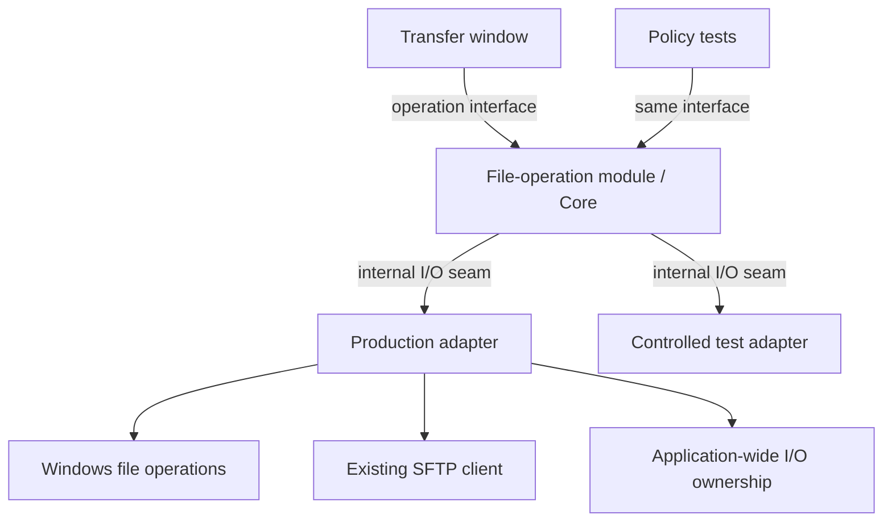

# File-operation module design

Status: design accepted and ready for implementation, 2026-11-14. Architecture
interview Q1-Q11, including the final shared-understanding review, are accepted.
Implementation and prototyping require a separate explicit user request.
No implementation tests were run for this consolidation.

The [architecture interview](../drafts/architecture-deepening.md) records the
decisions and alternatives. The [SFTP file-transfer contract](file-transfer.md)
continues to define file behavior, confirmation choices, path handling, limits,
and transport requirements. This document defines responsibility and lifetime
for those behaviors, including Q8-Q10's admission and retention decisions.

## Responsibility and seams

The file-operation module in `TabTty.Core` owns copy/upload/download, deletion,
rename, and folder creation. Its implementation is independent of WPF. The
transfer window and tests use the same interface. Copy and deletion retain
their distinct algorithms inside the module.

Production and test adapters are alternatives at the internal seam. The diagram
does not imply that both perform an operation together.

| Responsibility | Owner |
| --- | --- |
| Browsing, selection, path/name input, drag validity, dialogs, localized display | Transfer window and presentation adapter |
| Admission, captured request, preflight, confirmation validity, execution, cancellation, results, retry selection | File-operation module |
| Windows operations, source/destination attributes and identity checks, file data, native recycling, low-level completion facts | Production I/O adapter, reusing the useful `TransferFiles` knowledge |
| SFTP framing, request replies, channel identity, transport flow control and close | Existing SFTP/SSH implementation |
| Outstanding-I/O ownership and shared resource/serialization lifetime across windows | Application-wide I/O management, without references to UI controls |
| Scripted I/O completion, failure, target mutation, and delayed completion | Controlled test adapter |

The external seam exposes file operations and observable results rather than
recursive algorithms or mutable execution state. This gives callers leverage
through a deep interface and concentrates policy changes and verification for
locality. Deleting the existing I/O knowledge would spread complexity back to
callers; it remains behind the internal seam.

## Operation interface

Use named copy, delete, rename, and folder-creation operations with opaque,
module-owned operation identity. Exact C# names and internal decomposition are
implementation choices. The interface also supports observing read-only state,
answering confirmation requests, requesting cancellation, retrying eligible
failed transfer items, and closing the operation context after a close decision.

An operation request captures its selected entries and destination/name as
bounded, stable values. Preserve remote raw-name bytes and the selected path
information; subsequent browsing does not retarget the operation. Captured
attributes do not replace the required live rechecks.

The module decides admission. A disabled button is a presentation of that
decision, not its enforcement. Reject a start when the connection is unavailable,
another operation is active, Q8/Q10 block mutations, or required capacity is
unavailable. Rejected starts do not clear the latest results. Preserve the
existing immediate-admission model without adding a queue of future operations.

Read-only state identifies the owning module and operation and describes
admission, progress, pending confirmation, per-item results, retry availability,
and outstanding I/O or cleanup. Observation begins with current state; updates
may coalesce progress, while pending questions and retained results remain
observable. Presentation dispatch must discard callbacks for a detached view or
an old owner. Detaching observation does not itself request cancellation.

Ordinary rejection and file-operation failure produce observable outcomes; a
caller must not infer success from acceptance or infer no effects from
cancellation. The module completes execution management itself. No caller-side
`End` call or disposal of an operation handle is required to release admission.
Logical operation completion and actual I/O completion remain distinct.

## Confirmation and cancellation

The module determines when the existing initial deletion, overwrite, and
permanent-deletion fallback confirmations are needed. It supplies the question's
facts and permitted choices; the presentation adapter owns the dialog and locale
resources. Names and internal identifiers do not depend on translated text.

Each pending question belongs to one operation on one connection. Only its
current answer can authorize the next step. Cancellation, disconnect, or an
accepted close invalidates that question; delayed or duplicate answers cannot
authorize work. Waiting for a dialog must not prevent invalidation, and waiting
for local user input remains excluded from the existing I/O deadlines.

After a valid answer, the module rechecks the target as required by the transfer
contract. An observed target change requires a fresh overwrite decision. A
failed or missing response is never treated as approval. Recycling failure
allows the specified permanent-delete question only when fallback is valid;
an unknown recycling outcome does not authorize a second destructive attempt.

Cancellation stops new operation work while preserving confirmed effects and
required cleanup. Already-issued I/O retains its original owner. Keep per-item
completed, skipped, failed, unfinished, and unknown outcomes distinct. A lost
mutation reply can produce unknown outcome; do not replay an uncertain commit
or remove its final path as cleanup. Retain unresolved temporary paths when
cleanup cannot be confirmed.

While cancelled work has outstanding I/O, the affected connection's transfer
window cannot admit another mutation. Browsing and closing remain available;
available browsing controls do not guarantee a stalled provider will answer.
Once I/O has retired, apply the contract's required refresh/rechecks before
admitting further mutations. A UI refresh alone does not retire pending I/O.

## Results and retry

Retain one latest operation's bounded result set together with its eligible
retry metadata. Replace both only after the next operation is accepted. A
rejected start, including capacity rejection, preserves both. Closing the
transfer window discards display results and retry metadata; reopening does not
restore a history of operations. A disconnected window that remains open keeps
its results.

Retry uses the module's retained failed transfer items on the original live
connection, with current source, destination, and collision checks from the
beginning. Unknown outcomes are not ordinary failed items and must not become
automatic replay. Preserve existing retry scope; create, rename, or delete do
not become replayable merely because they share the module.

Per-item outcome, reason, path facts, and metadata/cleanup warnings are
independent of rendered strings. Plan, result, and retry storage share the
existing entry/path/memory bounds. Report capacity or omitted detail explicitly
rather than maintaining an unbounded event history. Display retention never
determines when outstanding-I/O ownership can be released.

For the latest accepted operation, retain unresolved outcomes and their known
paths ahead of ordinary result details. Omit ordinary entries such as successes
first and indicate the omission. Before creating a destination temporary file,
ensure its path can be retained within the existing limits if cleanup cannot
be confirmed. If capacity is still insufficient, report the capacity failure
before starting the write for that file. Keep earlier unresolved details.

## Connection, window, and resource lifetime

Bind each operation context to its terminal session's current connection.
Tab movement changes visual ownership without reconnecting or replacing it.
After reconnect, an explicit transfer open uses a new module and the new
connection; old answers, progress, results, and retry state cannot attach to it.

After the existing close confirmation, invalidate questions and stop work.
Use the existing bounded close policy and expose known unresolved paths or
outcomes before dismissal. Closing a view releases its presentation bindings,
not the ownership of I/O that still exists.

The close report shows the count for each kind of unresolved outcome and
initially displays the first ten unresolved entries in total. The user can
inspect every remaining entry and its known path in the same report before
dismissing the window. Use the latest operation's unresolved outcomes for
both direct window closure and closure with the terminal tab.

Application-wide management retains that I/O's original connection/operation,
completion tracking, provider reservations, and required mutation serialization
until actual completion. Reopening a view on the same connection consults this
ownership and inherits the admission restriction. A new connection does not
release old I/O reservations or local serialization even though its operation
module is new. Late completion may retire original work; it cannot complete a
different operation or re-enable the old connection.

Keep the shared four-transfer-batch limit separate from the eight-local-provider-
call limit. Create, rename, and delete do not acquire an extra application-wide
four-batch restriction. A local provider call remains charged until it actually
returns. Required local mutation serialization follows the actual I/O lifetime,
not the lifetime of the task waiting for it, and still covers the contract's
same-resolved-destination mutations across tabs.

This ownership does not lock external writers or provide an SFTP filesystem
snapshot. Invalidate old remote request identities according to the existing
channel-close rules. Final application exit retains the existing bounded-wait
and no-hidden-background-application policy; this design adds no persistent
cleanup process, operation restoration, or promise that exit proves all external
effects completed.

## Internal I/O contract and verification

The internal seam supplies actual attributes, identity, data, and execution
outcomes to the production policy module. The adapter must distinguish work
not issued, confirmed completion/failure, and work with an unconfirmed effect;
it must also expose when outstanding provider ownership can actually retire.
Cancellation of a waiter cannot manufacture a confirmed failure or release
resources still owned by the provider. Keep approval and retry decisions in
the policy module rather than implementing them again in each adapter.

Use the controlled adapter to schedule attribute changes, failures, lost replies,
and delayed completions. Where deadlines are involved, control time so the test
does not depend on wall-clock races. Exercise the real module through the same
named operations, observation, answers, and cancellation used by the window.

| Required check | Observable result |
| --- | --- |
| Child deletion fails | Completed effects remain; the affected top-level tree stops; failed and unfinished entries are distinct; other selected trees continue where permitted. |
| Target changes during confirmation | Recheck detects it and obtains the required fresh decision. |
| Cancellation/disconnect wins before an answer is used | A late approval causes no new mutation. |
| A mutation may succeed but its reply is lost | Unknown outcome is retained; no automatic replay or final-path cleanup occurs. |
| Ordinary results fill the display before a later temporary file's cleanup is unconfirmed | The close report still gives the temporary path. If space for another temporary path cannot be retained, that file's write never starts and the capacity failure is visible. |
| One transfer batch reports twelve unconfirmed temporary-file cleanups and one unknown final rename | Closing by either route shows counts of twelve and one, ten entries initially, and access to all thirteen results before dismissal. |
| Provider finishes after cancellation | Q8 admission remains blocked and resources remain owned until actual retirement. |
| View closes/reopens during outstanding work | Results are discarded, but I/O ownership and same-connection admission restrictions survive. |
| Reconnect occurs before old completion | A new owner is used; old results/answers cannot affect it and old resources are not released early. |
| A start is rejected, then another is accepted | Rejection preserves the latest result/retry set; acceptance replaces it together. |
| Retry is requested | Only eligible failed transfer items on the original live connection are retried after current checks. |

Retain real SSH/SFTP tests for channel separation, request draining, bytes,
rekey, refusal, and terminal responsiveness; retain Windows tests for recycling,
identity/no-follow behavior, replacement, and dialog integration. The test
adapter establishes policy behavior, not those platform/protocol guarantees.

During later implementation, move existing policy assertions onto this shared
interface and preserve their observable guarantees. Keep integration checks that
cover different behavior; avoid duplicating tests solely for private helper
methods. Recheck the existing resource and release gates before delivery.

## Readiness

The [interview's source-review findings](../drafts/architecture-deepening.md#contract-discrepancy-to-preserve-in-implementation-preparation)
identify the old-window reconnect path, premature mutation-serialization release,
and display/retry lifetime mismatch that later implementation must address.
They are not executed reproductions or fixes in this documentation work.

Q11 confirms this consolidated design and establishes implementation readiness
for this architecture candidate. The user requested continuing to candidate 2,
retained-terminal-buffer observation. Implementation still requires an explicit
user request. ADR 0001 and ADR 0003 remain unchanged; no macro
runtime, new SSH connection strategy, or additional dependency is introduced.
